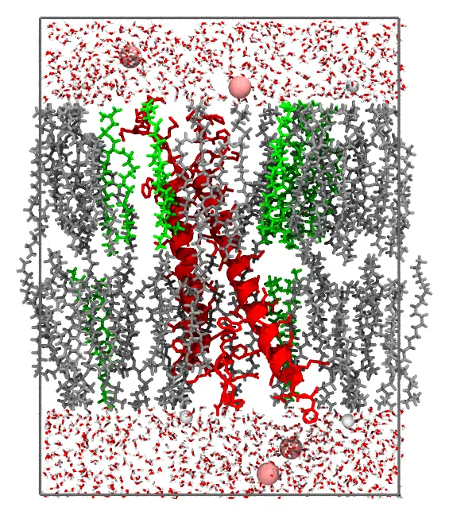

```@meta
CollapsedDocStrings = true
```
# Membrane protein system

`MembraneProtein` inserts a membrane protein in a lipid bilayer of a given composition, and
solvates it with water and ions, under orthorhombic periodic boundary conditions.

```@docs
MembraneProtein
write_packmol_input(::MembraneProtein)
packmol(::MembraneProtein)
```

## The protein

The protein must be oriented for the membrane, as the structures of the
[OPM database](https://opm.phar.umich.edu) are: the membrane normal along `z`, and the
middle of the bilayer at `z = 0`. Download the structure from OPM, and remove its `DUM`
atoms, which mark the boundaries of the membrane (for example, with PDBTools:
`write_pdb("protein.pdb", read_pdb("1abc.pdb", "not resname DUM"))`). The protein is kept
fixed at the coordinates of the file. The example below is the transmembrane and
cytoplasmic domains of the integrin αIIbβ3 (PDB 2K9J, as oriented by OPM), with two
helices crossing the membrane.

## An example

The integrin in a POPC/POPS 4:1 bilayer, with 0.15 M NaCl:

```@example membrane_protein
using Packmol
system = MembraneProtein(
    protein = joinpath(Packmol.RecipesDirectory, "test", "data", "integrin_tm.pdb"),
    lipids = ["POPC", "POPS"],
    lipid_molar_ratio = [4, 1],
)
```

```@example membrane_protein
write_packmol_input(system; input = "membrane_protein.inp", output = "membrane_protein.pdb")
```

```julia
packmol(system; output = "membrane_protein.pdb")
```

It packs in about 10 seconds with 14 threads. A slab through the protein (the protein in
red):



## How the system is built

- The cell extends `margin` (15 Å) beyond the protein in `x` and `y`, and `solvent_margin`
  (15 Å) beyond the heads of the lipids and beyond the protein in `z`.
- The lipids are placed as in the [Membrane system](@ref): the ends of their chains within
  6 Å of the middle of the bilayer, and their heads beyond 6 Å + 0.85 L. The number of
  lipids of each leaflet fills the area of the cell without the cross-section of the protein
  in the leaflet, at the area per lipid (that of the actual membrane, for the built-in
  lipids).
- The water and the ions fill the slabs beyond the heads. Their volume without the protein
  is estimated by Monte Carlo (as [`free_volume`](@ref)): the ions at the ionic
  concentration, with counterions to neutralize the charge of the protein (computed from its
  residues, or given as `protein_charge`), and the water to the density of the salt
  solution, as in the [Solute-Water-Ions system](@ref).

## Equilibrating the system

The packed system has no overlaps, but it is not equilibrated. The built-in lipids are
extended conformations, so the bilayer is thicker than a relaxed one, and than the
hydrophobic belt of the protein, and the lipids are not yet in contact with the protein as
in an equilibrated membrane. Minimize the energy of the system, and equilibrate it with
molecular dynamics at constant pressure (NPT, with semi-isotropic pressure coupling, so
that the area and the thickness of the membrane relax independently), with position
restraints on the atoms of the protein (on its heavy atoms, or on its backbone), released
gradually, until the area per lipid and the thickness of the membrane are stable. Only then
start the production simulation.
