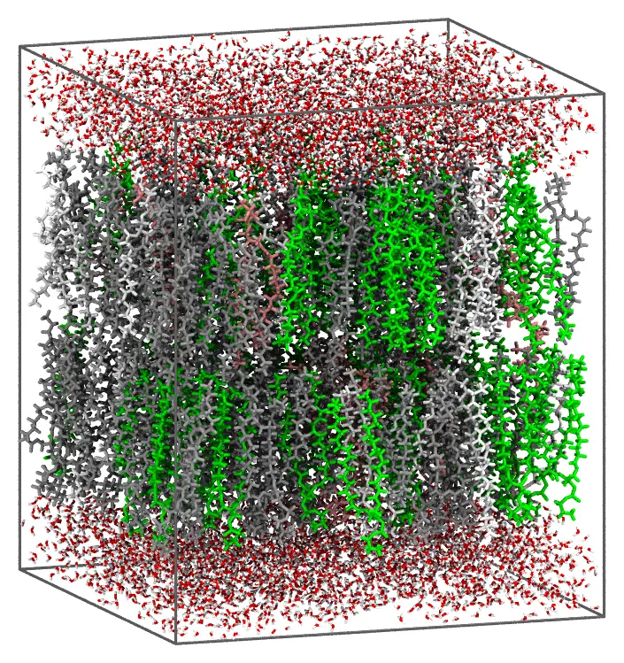
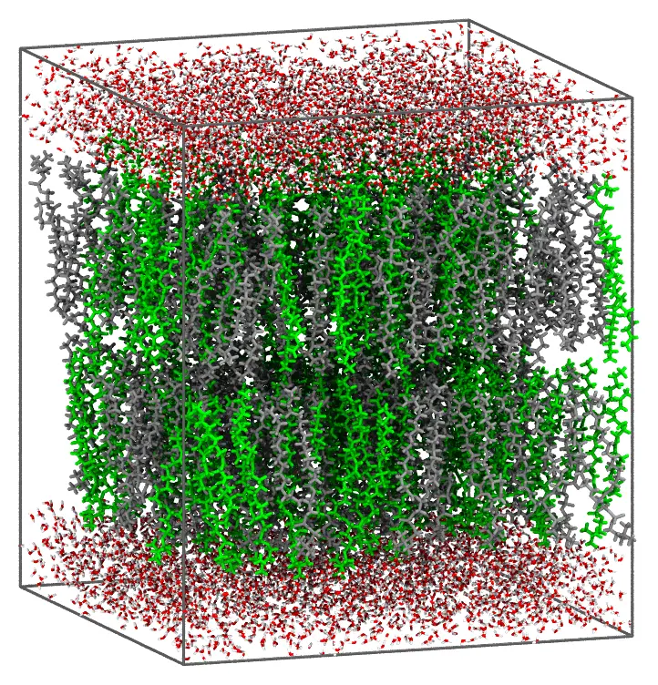

```@meta
CollapsedDocStrings = true
```
# Membrane system

`Membrane` builds a lipid bilayer or monolayer under orthorhombic periodic
boundary conditions, with the membrane normal along z. Seven common
phospholipids are built in, POPC, POPE, POPS, POPG, DPPC, DOPC and DMPC: for
them, only the composition and the size of the membrane are needed. Unlike the
solvation recipes, every parameter is given in the `Membrane` constructor:
`write_packmol_input`/`packmol` take only `input`/`output` (and, for
`packmol`, any keyword of the packing engine).

```@docs
Membrane
write_packmol_input(::Membrane)
packmol(::Membrane)
```

## A bilayer of a single lipid

A POPC bilayer of 128 lipids (64 in each leaflet), in water:

```@example membrane
using Packmol
system = Membrane(lipids = "POPC", total_lipids = 128)
```

The area per lipid is, by default, that of the actual membrane (64 Ų for
POPC). The size can also be given by the lateral area of the box,
`total_area` (Ų), instead of the number of lipids.

Generate the input file, or pack the system directly:

```@example membrane
write_packmol_input(system; input = "popc.inp", output = "popc.pdb")
```

```julia
packmol(system; output = "popc.pdb")
```

## Mixtures

The molar ratio of the lipids is given by `lipid_molar_ratio` (equal amounts
if not given). An anionic membrane of POPC, POPE, POPS and POPG, at 4:3:2:1:

```@example membrane
system = Membrane(
    lipids = ["POPC", "POPE", "POPS", "POPG"],
    lipid_molar_ratio = [4, 3, 2, 1],
    total_lipids = 200,
)
write_packmol_input(system; input = "mixture.inp", output = "mixture.pdb")
```

Both leaflets have the same composition, and the area per lipid is the molar
average of those of the lipids. The system packs in about 20
seconds with 14 threads, and looks like this (the lipids colored by type):



Lipids of different lengths are packed with their heads at their own
heights, from the same middle of the bilayer. DPPC and DOPC, 1:1:

```@example membrane
system = Membrane(lipids = ["DPPC", "DOPC"], total_lipids = 200)
write_packmol_input(system; input = "dppc_dopc.inp", output = "dppc_dopc.pdb")
```



## A monolayer

With `type = :monolayer`, a single leaflet, with the heads toward the
solvent above it:

```@example membrane
system = Membrane(type = :monolayer, lipids = "DPPC", total_lipids = 64)
write_packmol_input(system; input = "monolayer.inp", output = "monolayer.pdb")
```

## How the lipids are placed

The length L of each lipid is the distance from its head atom to the
midpoint of the ends of its chains. In a bilayer, the ends of the chains are
packed within 6 Å of the middle of the membrane, and the head of each lipid
beyond 6 Å + 0.85 L from it, in the same way as in the
[bilayer tutorial](@ref "Lipid bilayer"): keeping the heads in a narrow band
keeps the lipids upright, which is what makes them pack. The solvent starts
2 Å beyond the heads. The width of the band of the heads, 0.15 L, is the
`flexibility` keyword: wider bands make the packing slower, or make it fail.
A monolayer is packed in the same way, from the bottom of the box.

The built-in lipids are extended conformations, which pack well, but make a bilayer
thicker than a relaxed one (and its area per lipid is that of the actual membrane): the
equilibration of a molecular dynamics simulation at constant pressure (NPT, with
semi-isotropic pressure coupling) brings it to its thickness and area.

## Other lipids and solvents

Any lipid can be given as a PDB file, with the index of its head atom
(`lipid_head`), those of the ends of its chains (`lipid_tail`, a vector for
each lipid), and the area per lipid, for all the lipids (the built-in ones
can be mixed with them, by name). Packing is fastest with straight, compact
conformations, with the chains side by side, as those of the built-in lipids
(the `packmol_lipids` set of
[MolSimTestFiles](https://github.com/m3g/MolSimTestFiles), which has 20
conformations of each). The solvent can be any mixture, with its molar
ratios and density. Here, a single-chain lipid (its head atom is the 31st,
the end of its chain the first) in water/ethanol:

```@example membrane
test_dir = Packmol.RecipesDirectory * "/test"
system = Membrane(
    lipids = "$test_dir/data/lipid.pdb",
    lipid_head = [31],
    lipid_tail = [1],
    area_per_lipid = 30.0,
    total_lipids = 100,
    solvent = ["$test_dir/data/water.pdb", "$test_dir/data/ethanol.pdb"],
    solvent_molar_ratio = [9, 1],
    solvent_density = 0.98u"g/mL",
    solvent_layer_width = 20.0,
)
write_packmol_input(system; input = "membrane.inp", output = "membrane.pdb")
```
