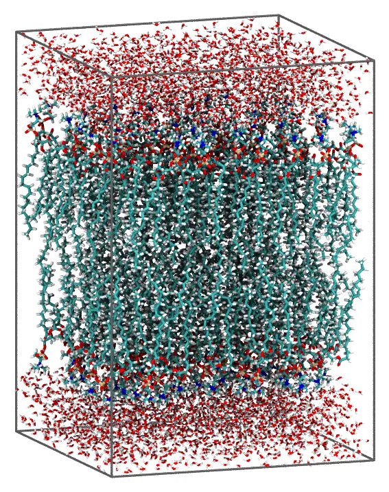
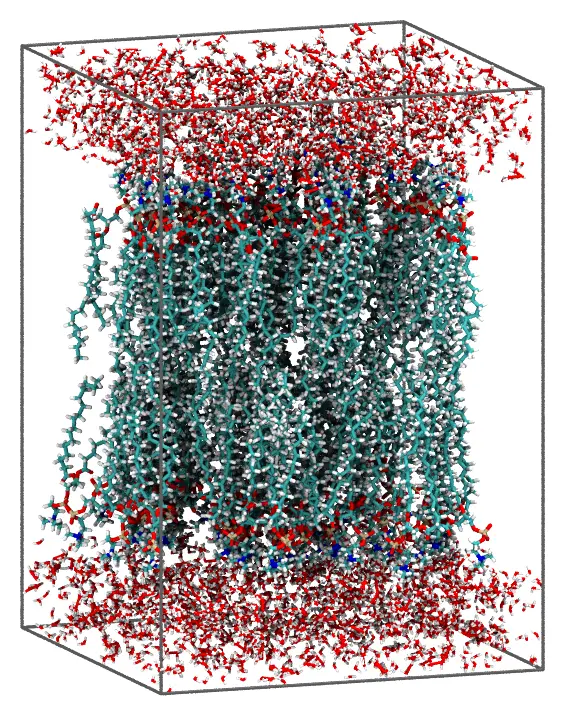

# Lipid bilayer

A POPC bilayer in water, with periodic boundary conditions. The lipids of each leaflet
are oriented by constraints on two of their atoms: the polar heads point to the water,
and the ends of the hydrophobic chains to the middle of the bilayer.



*The bilayer seen from the side, with the edges of the periodic cell.*

Files: [`popc.pdb`](files/bilayer/popc.pdb), [`water.pdb`](files/bilayer/water.pdb) and
the input file [`bilayer.inp`](files/bilayer/bilayer.inp).

## The lipid

How well lipids pack depends a lot on their conformation: extended, compact
conformations, with the two chains side by side, pack at the densities of real
membranes, while others do not pack at all. `popc.pdb` is one of the conformations of
the `packmol_lipids` set of
[MolSimTestFiles](https://github.com/m3g/MolSimTestFiles), which has conformations
chosen to pack well for POPC, POPE, POPS, POPG, DPPC, DOPC and DMPC, and describes how
they were obtained (download the whole set:
[packmol_lipids.tar.gz](https://github.com/m3g/MolSimTestFiles/releases/download/packmol_lipids-v1/packmol_lipids.tar.gz)).

In `popc.pdb`, atom 1 is the nitrogen of the choline (the polar head), and atoms 88 and
131 are the ends of the two hydrophobic chains. The distance from the head to the
middle of the chain ends is 26 Å.

## The numbers

The area per lipid in a fluid POPC bilayer is about 64 Ų. With 60 lipids per leaflet,
the membrane has 60 × 64 = 3840 Ų, a square with sides of 61.96 Å. Each layer of water
has 15 Å, with 61.96² × 15 = 57600 ų: at 1 g/mL (29.9 ų per molecule), 1925 water
molecules.

The head atoms of the upper leaflet are constrained to be above z = 28 Å, and the chain
ends below z = 6 Å. These planes are 22 Å apart, 85% of the length of the lipid, so the
lipids stay nearly upright (they can tilt by about 30°), with their heads in a narrow
band. Keep these planes close to the length of the lipid: with the heads only 50% of
the length away from the chain ends, the lipids slide along their axes, the chains of
one leaflet push into the other, and the packing gets stuck.

## Command line

The input file:

```
#
# POPC bilayer in water, with periodic boundary conditions
#
tolerance 2.0
output bilayer.pdb

# Periodic box: 60 lipids per leaflet at 64 Ų per lipid (61.96 Šsides in x and y),
# membrane centered at z = 0, 15 Å of water above and below it
pbc -30.98 -30.98 -45. 30.98 30.98 45.

# Upper leaflet: the head (atom 1, N) above z = 28, the ends of the two chains
# (atoms 88 and 131) below z = 6
structure popc.pdb
  number 60
  atoms 1
    above plane 0. 0. 1. 28.
  end atoms
  atoms 88 131
    below plane 0. 0. 1. 6.
  end atoms
end structure

# Lower leaflet: the same, mirrored
structure popc.pdb
  number 60
  atoms 1
    below plane 0. 0. 1. -28.
  end atoms
  atoms 88 131
    above plane 0. 0. 1. -6.
  end atoms
end structure

# Water: 15 Å above and below the membrane (the two slabs are continuous
# through the periodic boundary in z)
structure water.pdb
  number 1925
  above plane 0. 0. 1. 30.
end structure

structure water.pdb
  number 1925
  below plane 0. 0. 1. -30.
end structure
```

The constraints inside an `atoms ... end atoms` block apply only to the atoms listed:
here, only the head and the chain ends of each lipid are constrained, and the rest of
the molecule follows them. `above plane 0. 0. 1. 28.` is the half-space
`0x + 0y + 1z ≥ 28`, that is, `z ≥ 28`. The chain ends of the two leaflets can meet
anywhere between z = -6 and z = 6, so the leaflets interdigitate a little. The water is
only constrained by one plane, and the box: the water above the membrane fills the box
from z = 30 to its top face, at z = 45, which is in contact, through the periodic
boundary, with the water below the membrane.

### Check the initial approximation first

For a system with two lipid layers oriented by constraints on some of their atoms,
first check that the constraints place the molecules where intended. Add the `check`
keyword to the input file:

```
check
```

and run it as below. Packmol then only builds the initial approximation, in a few
seconds: each molecule is placed in its region, satisfying the constraints, but the
molecules may still overlap. It is written to the output file (`bilayer.pdb`). Look at
it in a molecular visualization program:



*The initial approximation: the lipids are already oriented by the constraints on their
head and tail atoms, but molecules may overlap.*

When the molecules are where they should be, remove `check`, and run the packing.
If the constraints cannot be satisfied at all, even without the distances between the
molecules, Packmol stops after the initial approximation with an error (unless the
`continue_failed_initial_packing` keyword is set): that is almost always a sign of
wrong constraints.

### Packing

Run it with:

```
packmol bilayer.inp
```

The packed system (about 28 thousand atoms) is written to `bilayer.pdb`, in about a
minute and a half with 8 threads.

## Julia

The `atom_constraints` keyword of [`structure_type`](@ref) is the equivalent of the
`atoms ... end atoms` blocks: a list of `atom indices => constraints` pairs.

```julia
using Packmol

z = [0., 0., 1.] # the normal of the planes
# Heads (atom 1) above z = 28, chain ends (atoms 88 and 131) below z = 6
upper_leaflet = structure_type("popc.pdb";
    number = 60,
    atom_constraints = [
        [1] => AbovePlane(z, 28.0),
        [88, 131] => BelowPlane(z, 6.0),
    ],
)
# The same, mirrored
lower_leaflet = structure_type("popc.pdb";
    number = 60,
    atom_constraints = [
        [1] => BelowPlane(z, -28.0),
        [88, 131] => AbovePlane(z, -6.0),
    ],
)
water_above = structure_type("water.pdb";
    number = 1925,
    constraints = [AbovePlane(z, 30.0)],
)
water_below = structure_type("water.pdb";
    number = 1925,
    constraints = [BelowPlane(z, -30.0)],
)

system = PackmolSystem([upper_leaflet, lower_leaflet, water_above, water_below];
    output = "bilayer.pdb",
    tolerance = 2.0,
    unitcell = [61.96 0. 0.; 0. 61.96 0.; 0. 0. 90.], # centered at the origin
)
packmol(system)
```

As with the input file, check the initial approximation first, by building the system
with `check = true` (`PackmolSystem(...; check = true)`): `packmol(system)` then writes
the initial approximation to the output file, and stops.

`BelowPlane(normal, d)` and `AbovePlane(normal, d)` take the parameters of
`below plane` and `above plane`.

!!! tip
    The `Membrane` recipe builds bilayers like this one from a few parameters
    (lipid composition, area per lipid, solvent thickness), with periodic boundary
    conditions. See [Recipes](../recipes/index.md).
