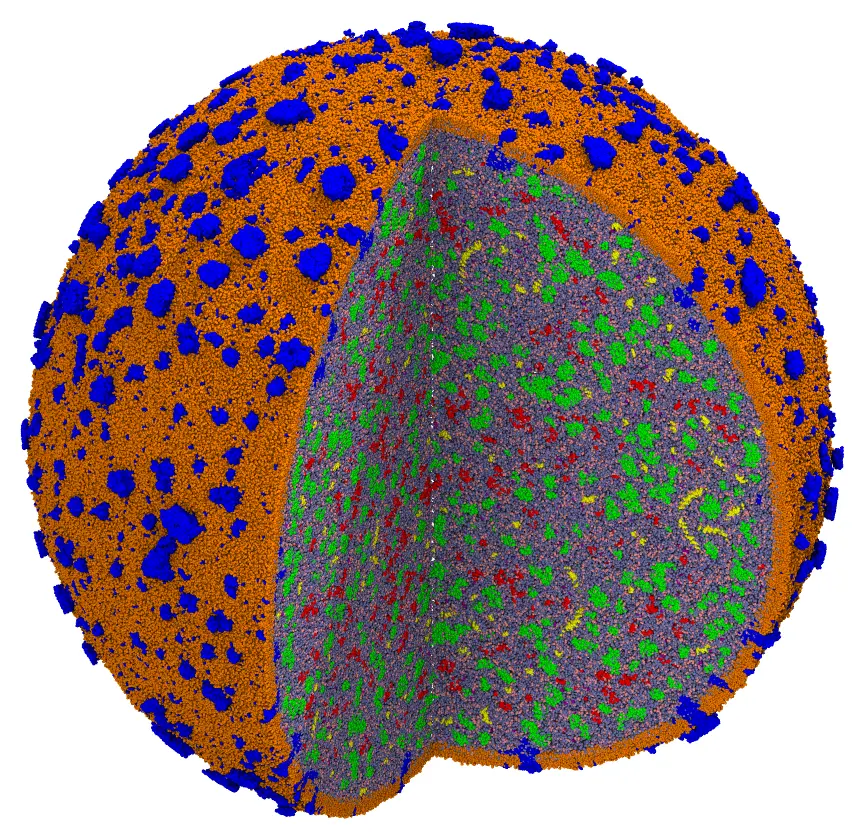
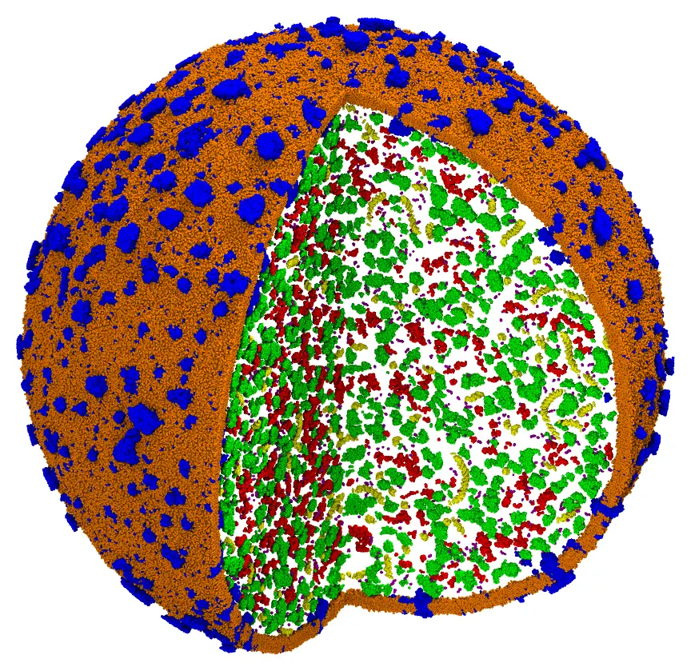

# Minimal cell (voxel placement of Bentopy)

The minimal bacterial cell JCVI-Syn3A, coarse-grained (Martini), built from the published
model of **[Bentopy](https://github.com/marrink-lab/bentopy)**:

> M. S. S. Westendorp et al., *Compartment-guided assembly of large-scale molecular
> models with Bentopy*, Protein Science (2026) e70480.
> [doi:10.1002/pro.70480](https://doi.org/10.1002/pro.70480)

Its membrane (with its proteins) and its chromosome are taken from Bentopy's model, and
fixed. The 41,967 proteins, RNAs and metabolites of the cytosol, those of Bentopy's
input, are placed by [`voxel_place`](@ref), the direct port to Julia of Bentopy's
placement algorithm (see [Placement on a grid (Bentopy)](@ref)), and packed by Packmol.
The cytosol is then solvated with water and glycerol. The final system has about 40
million beads.



*The cell with a quarter cut out: the membrane lipids (orange) and proteins (blue), the
chromosome (yellow), and the proteins (green), RNAs (red) and metabolites (purple) of the
cytosol, in water (light blue) and glycerol (pink).*

The data are those of the paper, not distributed with Packmol: download the archive of
the models of Bentopy from Zenodo,
[doi:10.5281/zenodo.17524049](https://doi.org/10.5281/zenodo.17524049) (4 GB, CC-BY
4.0), and extract it. The model of the cell is in its `cell` directory.

## The system

- **The membrane and the chromosome**, from Bentopy's model (`membrane.gro` and
  `chromosome.gro`), fixed. The membrane is a sphere of about 950 Å of radius.
- **The proteins, RNAs and metabolites**, the molecules of Bentopy's input
  (`input.bent`), in its numbers: in the cytosol, within 950 Å of the center of the
  membrane (the membrane, fixed, bounds them). The peripheral proteins (in Bentopy, within
  20 nm of the membrane) have the bead closest to their center beyond 630 Å.
- **The solvent**: Martini water and glycerol (15% v/v, a two-bead placeholder of
  glycerol), in the free volume of the cytosol.

A script converts the model to Packmol's input:

```@raw html
<details><summary>The script <code>prepare.jl</code> (click to expand)</summary>
```
```@eval
Main.input_file("files/cell/prepare.jl")
```
```@raw html
</details><br>
```

```
julia prepare.jl path/to/zenodo/cell
```

It writes the structures of the molecules (`structures/`), the membrane and the
chromosome (`membrane.cif`, `chromosome.cif`), the solvent (`w.pdb`, `gly.pdb`), and the
input file `cell.inp`, with a structure block per molecule of Bentopy's input:

```
tolerance 4.0
seed 1
output cell.cif

# The voxel placement of Bentopy, with its max-tries-mult for this model
voxel_place 100000

structure membrane.cif
  number 1
  fixed 0. 0. 0. 0. 0. 0.
end structure

structure chromosome.cif
  number 1
  fixed 0. 0. 0. 0. 0. 0.
end structure

structure structures/002_monomer.pdb
  number 19
  inside sphere 1070.8055 1068.5261 1064.6064 950.0
end structure
...
```

The tolerance of 4 Å, the diameter of the beads of Bentopy's model (2 Å of radius), gives
voxels of 5 Å, those of Bentopy's model.

## Command line

### Step 1: the voxel placement, and the packing

The keyword `voxel_place` places the molecules with the algorithm of Bentopy before the
packing. Molecules that do not fit are left out, as Bentopy does, and reported:

```
packmol cell.inp
```

The placement took 16 seconds: 41,835 of the 41,967 molecules fit, and 132 RNAs, each
of a structure type of a single molecule, did not, which the report lists with a
significant warning (all the molecules of those types were left out). These are the
numbers of Bentopy's own model, which also left out 132 RNAs. The packing then converged
at the first loop: the molecules placed on the voxel grid do not overlap (minimum
distance 4.05 Å). With reading the input and writing the output, a 4.2 GB mmCIF file,
this step takes 2 minutes with 14 threads, and 20 GB of memory.



*The output of the first step, cut as the image above: the molecules placed by the
voxel placement, and packed.*

### Step 2: the solvent

The output of the first step is fixed, and the cytosol is filled with water and
glycerol:

```@raw html
<details><summary>The input file <code>solvation.inp</code> (click to expand)</summary>
```
```@eval
Main.input_file("files/cell/solvation.inp")
```
```@raw html
</details><br>
```

```
packmol solvation.inp
```

The packing of 17.3 million water beads and 3 million glycerol placeholders converged in
2 loops, 8.5 minutes with 14 threads, using 80 GB of memory: the cell, with 39.6 million
beads, built in about 11 minutes.

## Julia

The same steps in Julia (after `julia prepare.jl path/to/zenodo/cell`):

```julia
using Packmol

# Step 1: the voxel placement, and the packing (the keyword voxel_place of cell.inp)
packmol("cell.inp") # check_initial_placement = true

# Step 2: the solvent
packmol("solvation.inp")
```

Or, with the voxel placement as a separate step, to check what was left out before
packing (with `voxel_place` removed from `cell.inp`):

```julia
placed, dropped = voxel_place("cell.inp"; max_tries_mult = 100_000)
packmol(placed)
```

!!! note "Bentopy"
    The placement algorithm, and the model of the cell, are Bentopy's: if you use them,
    please cite the paper above. For building cells and other crowded compartments,
    [Bentopy](https://github.com/marrink-lab/bentopy) itself offers more (compartments
    from voxel masks and their combinations, concentrations, and the features its authors
    keep adding); Packmol packs and solvates its output too, starting from its
    coordinates (`restart_from`).
