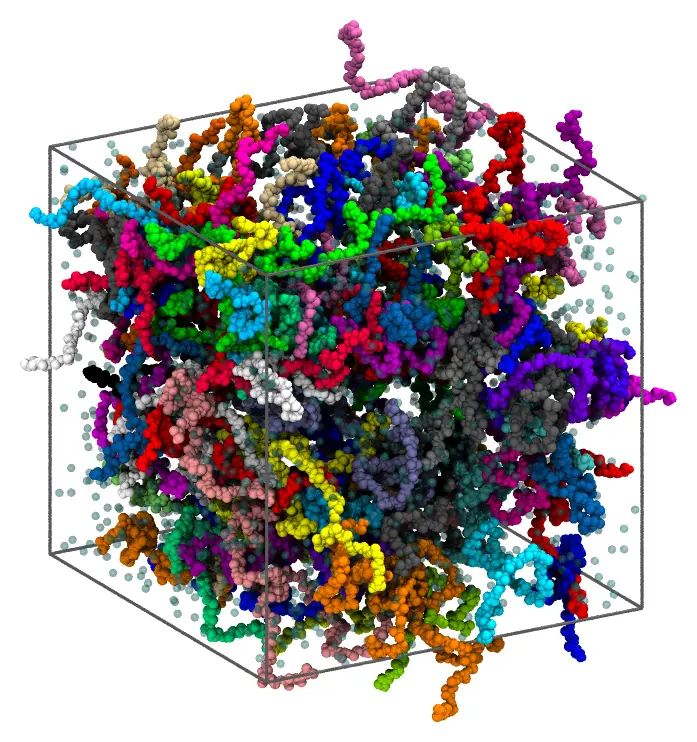
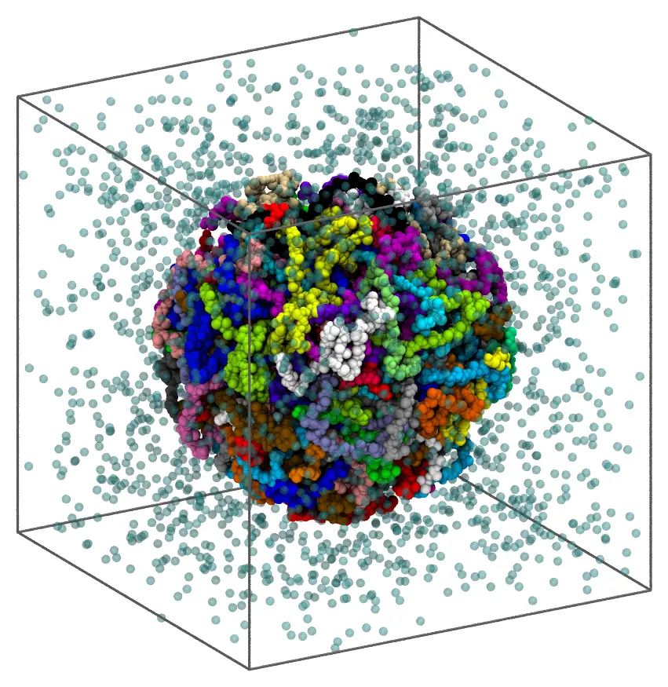
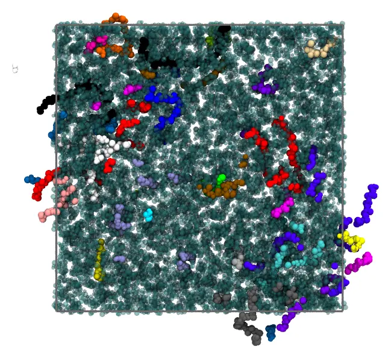
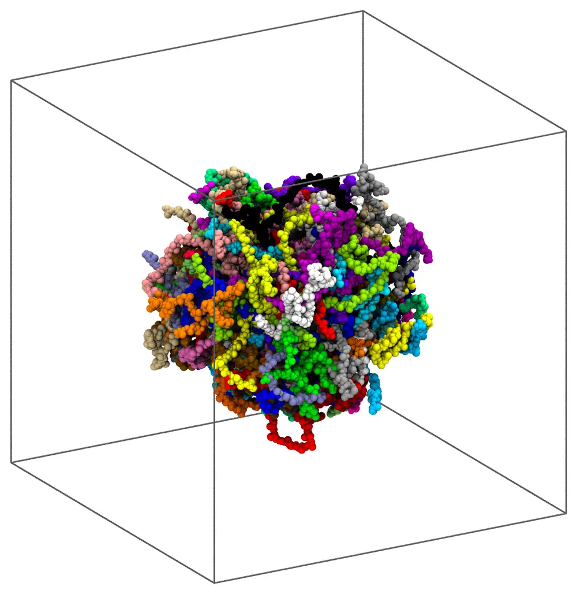
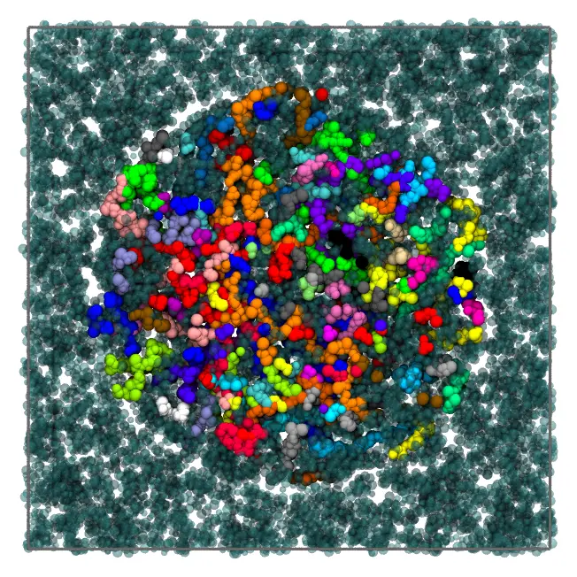

# Biomolecular condensate

Biomolecular condensates are droplets of proteins (often intrinsically disordered ones)
and nucleic acids, formed by liquid–liquid phase separation from the solution around
them, in which the proteins reach hundreds of mg/mL. Here, the protein is the
elastin-like polypeptide (VPGVG)₂₀, a disordered chain of 100 residues, in the
coarse-grained model [SIRAH](https://www.sirahff.com/), with its water model, WT4. The
same composition, 123 chains and 49,552 WT4 molecules in a periodic cube of 260 Å
(242,488 beads), is packed in two ways:

- a **homogeneous mixture**, from which the condensate forms in the simulation: the
  chains, at 95 mg/mL in the whole cell, pack in a few seconds;
- a **droplet** of 100 Å of radius, with the chains at 400 mg/mL, in the water: too dense
  to pack from a random placement, it is packed at half the density and compressed
  ([Packing by compression](@ref)).

The chains are flexible: they are [Polymers](@ref) of rigid monomers, held together by
links between the monomers.



*The homogeneous mixture: the chains, each in a color, with one in every 20 water
molecules shown.
The full-length chains are shown, each placed in the cell by its center: a chain of up to
100 Å crosses the faces of the cell, and its parts outside are the periodic images of
parts inside (with PBC, an artifact of the view only).*



*The droplet: the chains at 400 mg/mL, with one in every 20 water molecules
shown.*

Files: [`peptides.pdb`](files/condensate/peptides.pdb) (the conformations of the chains),
[`wt4.pdb`](files/condensate/wt4.pdb), and the input files
[`homogeneous.inp`](files/condensate/homogeneous.inp),
[`droplet_chains.inp`](files/condensate/droplet_chains.inp) and
[`droplet_water.inp`](files/condensate/droplet_water.inp).

## The chains

`peptides.pdb` holds 10 conformations of (VPGVG)₂₀ (one model each), random coils of
360 beads, with radii of gyration between 21 and 40 Å, in the bead names of SIRAH (GN,
GC and GO on the backbone, BCB and BCG on the side chains of valine and proline; glycine
has no side-chain bead).

!!! note "Conformations of the chains"
    Generating the conformations is not the job of Packmol, but of the user: they should
    come from a simulation of the free chain, for example a short molecular dynamics
    simulation at high temperature. The conformations of `peptides.pdb` were built by
    [`build_peptides.jl`](files/condensate/build_peptides.jl), a proof of concept only:
    self-avoiding random walks with dihedral angles from the regions of the
    Ramachandran plot of disordered proteins, mapped to the beads of SIRAH, with no
    force field behind them.

    Several conformations, rather than one, also matter for the simulation itself,
    independently of the packing: the chains start from different conformations, and
    the results depend less on that of a single one.

## The chains as polymers

A rigid chain does not fill the space between the others: packed as rigid molecules,
these chains jam at about 220 mg/mL, whatever their conformations. As
[Polymers](@ref), they are flexible: each chain is 20 monomers of VPGVG (18 beads), each
a rigid molecule, linked to the next one by the beads of the junction:

```
  repeat 20
    monomer 18
      link 17 1
      link 18 1
      link 18 2
  end repeat
```

Beads 17 and 18 of a monomer are the GC and GO of its last residue (a glycine), and beads
1 and 2 of the next monomer the GN and GC of its first residue (a valine): the three
links keep the distances of the junction, at their values in the conformation of the
chain (2.2 to 2.5 Å), and leave the monomers free to turn about it. Each chain is built
from the monomers of its own conformation, and the beads of different monomers are at
least 2.25 Å apart in all of them: no pair of beads is left out of the distances (see
[Polymers](@ref)).

The chains are first packed as rigid molecules, and then released: released overlapping
each other, the chains get threaded through each other's monomers, and do not separate.

Here the flexibility is at the level of the repeated pentapeptide: each monomer of 5
residues is rigid. It could be set at the level of the residues instead, each residue a
monomer linked to the next one: a `repeat 20` block of five `monomer` lines, of the
sizes of the residues (4, 4, 3, 4 and 3 beads for V, P, G, V and G), each with the links
of its junction to the next residue. Or with rotatable bonds along the backbone (see
[Rotatable bonds](@ref)). More monomers make the chains more flexible, and the packing
slower.

## The numbers of molecules

A chain has 8207.6 g/mol, and a volume of 9949 ų (0.73 mL/g, the specific volume of
proteins). In the droplet, a sphere of 100 Å of radius (4.19 × 10⁶ ų), 400 mg/mL is
123 chains, and the remaining volume holds 8985 WT4 molecules, of 330 ų each (a WT4
molecule represents 11 water molecules). The cube of 260 Å has 40,567 WT4 molecules
outside the droplet: 49,552 in all, the water of the homogeneous mixture.

## Homogeneous mixture

```@raw html
<details><summary>The input file <code>homogeneous.inp</code> (click to expand)</summary>
```
```@eval
Main.input_file("files/condensate/homogeneous.inp")
```
```@raw html
</details><br>
```

```
packmol homogeneous.inp
```

It packs in about 5 seconds with 14 threads: the chains and the water as rigid molecules
(4 seconds), and then the released chains, which satisfy the links and the distances at
once.



*A slab of 20 Å through the middle of the cell, with all the water.*

## Step 1: the chains of the droplet

The chains are packed alone, in the sphere, and the water around them, fixed, in the
second step (`compress` does not take fixed molecules, and the water packs in seconds
around the chains).

```@eval
Main.input_file("files/condensate/droplet_chains.inp")
```

With `compress 0.5`, the chains are first packed at half the density (0.5 is the
fraction of the density, and the default: `compress` alone is the same). The sphere and
the cell are expanded by 2^(1/3), to a sphere of 126 Å, in a cube of 328 Å, twice the
volume, and the chains are packed there, at 200 mg/mL: as rigid
molecules, then released. Then the system is compressed in steps back to the sphere of
100 Å: the positions of the chains, the sphere and the cell scaled together, and the
chains packed again from there at each step.

### Check the initial placement first

Uncomment the `check_initial_placement` line of the input file, and run it: the initial
placement is that of the expanded sphere, with the chains as rigid molecules, before
any packing:



*The initial placement, in the expanded cell: the rigid chains overlap each other.*

### Packing

```
packmol droplet_chains.inp
```

The packing at 200 mg/mL takes a few seconds, and the compression 15 to 20 steps, in 35
to 60 seconds with 14 threads:

```
  Compression step    1: density   58.32% of the target, not converged (4.3 s)
  Compression step    2: density   53.95% of the target, converged (0.2 s)
  Compression step    3: density   58.20% of the target, converged (0.4 s)
  ...
  Compressed to the density of the input in 20 steps (41.3 s).
```

## Step 2: the water

```@eval
Main.input_file("files/condensate/droplet_water.inp")
```

```
packmol droplet_water.inp
```

The chains of step 1 are fixed, and the water fills the droplet and the cell around it,
in a couple of seconds.



*A slab of 20 Å through the middle of the droplet: the chains, each in a color, and the
water between them and around the droplet.*

!!! tip "Hard packings"
    The two systems show two ways of building a system that does not pack at its
    density from a random placement:
    - pack the molecules where they pack easily, and let the simulation take them where
      they go (the homogeneous mixture, from which the condensate forms);
    - pack them at a lower density, and compress them ([Packing by compression](@ref)),
      for systems that must start in their final arrangement. The compression works also
      with rigid molecules, but flexible chains (polymers) go much further.

## Julia script

The same systems, built in Julia:

```julia
using Packmol

# The chains: 20 monomers of VPGVG (18 beads), linked by the beads
# of the junction
sequence = [20 => [monomer(18; links = [(17, 1), (18, 1), (18, 2)])]]

# The homogeneous mixture
chains = polymer_structure("peptides.pdb"; number = 123, sequence)
water = structure_type("wt4.pdb"; number = 49552)
homogeneous = PackmolSystem([chains, water];
    output = "homogeneous.pdb",
    tolerance = 2.0,
    unitcell = [260. 0. 0.; 0. 260. 0.; 0. 0. 260.], # centered at the origin
    # check_initial_placement = true,
)
packmol(homogeneous)

# The droplet, step 1: the chains at 400 mg/mL, packed at half
# the density and compressed
origin = [0., 0., 0.]
droplet_chains = PackmolSystem(
    [polymer_structure("peptides.pdb"; number = 123, sequence,
        constraints = [InsideSphere(origin, 100.)])];
    output = "droplet_chains.pdb",
    tolerance = 2.0,
    unitcell = [260. 0. 0.; 0. 260. 0.; 0. 0. 260.],
    compress = 0.5,
)
packmol(droplet_chains)

# Step 2: the water, around the fixed chains
droplet = PackmolSystem([
        structure_type("droplet_chains.pdb"; number = 1,
            fixed = (origin, origin)),
        structure_type("wt4.pdb"; number = 8985,
            constraints = [InsideSphere(origin, 100.)]),
        structure_type("wt4.pdb"; number = 40567,
            constraints = [OutsideSphere(origin, 100.)]),
    ];
    output = "droplet.pdb",
    tolerance = 2.0,
    unitcell = [260. 0. 0.; 0. 260. 0.; 0. 0. 260.],
)
packmol(droplet)
```
