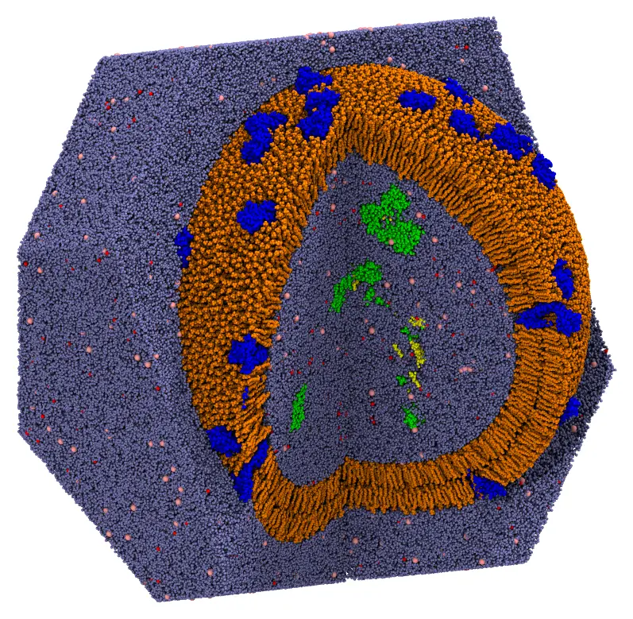
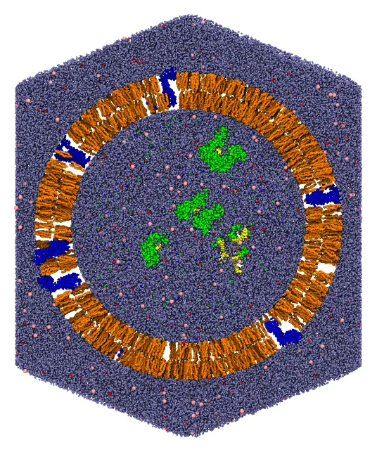

# Exosome (a very large system)

An exosome, an extracellular vesicle of 51 nm, with all atoms: an asymmetric lipid
bilayer crossed by 80 copies of the tetraspanins CD81 and CD9, 8 complexes of
Argonaute-2 with a microRNA and 2 nucleosomes inside, and water and NaCl (0.15 mol/L)
inside and outside, in a truncated octahedron periodic cell with 580 Å between opposite
hexagonal faces. The system has 13.6 million atoms and 3.6 million molecules. It is
packed in two steps: first the proteins, then the lipids, the water and the ions around
them.



*The exosome with a quarter cut out: the tetraspanins (blue) crossing the bilayer
(orange), the Argonaute-2 complexes and the nucleosomes in the lumen (green, with their
nucleic acids in yellow), water (light blue), and sodium (red) and chloride (pink) ions. The water outside is shown only behind the
exosome.*

The files are the `packmol_exosome` set of
[MolSimTestFiles](https://github.com/m3g/MolSimTestFiles): download and extract
[packmol_exosome.tar.gz](https://github.com/m3g/MolSimTestFiles/releases/download/packmol_exosome-v1/packmol_exosome.tar.gz)
(1 MB), which contains the two input files, `proteins.inp` and `exosome.inp`, and the structures,
as mmCIF files: `cd81.cif` and `cd9.cif` (the tetraspanins), `ago2_mirna.cif` (the
complex of Argonaute-2 with a microRNA), `nucleosome.cif`, `popc.cif`, `pope.cif`,
`pops.cif` and `dppc.cif` (the lipids), `water.cif`, `sodium.cif` and `chloride.cif`.

## The system

- **The proteins.** CD81 (OPM 5TCX) and CD9 (OPM 6K4J), Argonaute-2 with a microRNA
  (PDB 4W5N) and the nucleosome (PDB 1KX5), with hydrogens. Preparing the structures of
  the proteins (adding missing atoms and hydrogens, for example with
  [PDBFixer](https://github.com/openmm/pdbfixer)) is not a task of Packmol. The
  tetraspanins are in the frame of the [OPM](https://opm.phar.umich.edu/) database: the
  normal of the membrane along z, the middle of the membrane at z = 0, and the
  extracellular side at z > 0.
- **The lipids.** The membrane is asymmetric, as the plasma membrane from which exosomes
  bud: the outer leaflet has POPC and DPPC (standing for sphingomyelin), 2:1, and the
  inner one POPE, POPS and POPC, 2:1:1. The lipids are the built-in lipids of Packmol.jl
  (see [`Packmol.builtin_lipid`](@ref)), oriented as in the
  [Nanoliposomes](nanoliposome.md) tutorial: the head atom in a band, the ends of the
  chains within 6 Å of the middle of the bilayer, at 228 Å from the center. The number of
  lipids of each leaflet is that of the most crowded surface of the leaflet, plus 10%,
  minus the cross-sections of the proteins in the leaflet (see
  [`Packmol.cross_section`](@ref)): 10,037 lipids outside and 8,111 inside.
- **Water and ions.** Water at 1 g/mL in the volumes left inside and outside the vesicle,
  NaCl at 0.15 mol/L, and counterions for the charges of the contents of the lumen and
  of the POPS (inside) and of the tetraspanins (outside).

The numbers of molecules were computed, and the input files written, by a script of the
repository of Packmol.jl,
[`dev/tutorials/exosome.jl`](https://github.com/m3g/Packmol.jl/blob/main/dev/tutorials/exosome.jl).

The regions, as distances from the center of the vesicle:

| Component | Region (Å) |
|---|---|
| Tetraspanins | Cα atoms 18 to 24 Å from the middle of the membrane: outside 245 (extracellular side), inside 211 (intracellular side) |
| Argonaute-2 complexes and nucleosomes | below 191.7 |
| Inner leaflet (POPE, POPS, POPC) | head atom below 200, ends of the chains above 222 |
| Outer leaflet (POPC, DPPC) | ends of the chains below 234, head atom above 256 |
| Water and ions inside | below 196.7 |
| Water and ions outside | above 258.1, up to the faces of the periodic cell |

## Command line

### Step 1: the proteins

The proteins are packed first, alone, and then fixed in the packing of the rest of the
system. Large molecules that are not part of a continuous phase are best packed this
way: packed together with the water, they start overlapping it, and the water trapped
inside them is slow to leave.

The tetraspanins are oriented across the membrane as the lipids are, by constraints on
some of their atoms: the Cα atoms 18 to 24 Å from the middle of the membrane, on the
extracellular side, outside a sphere 17 Å beyond the middle of the membrane, and those
on the intracellular side inside a sphere 17 Å within it. The proteins then cross the
membrane, with the extracellular side outwards, tilted by 10° on average. The indices of
these atoms were taken from the coordinates of the structures in the OPM frame.

```@raw html
<details><summary>The input file <code>proteins.inp</code> (click to expand)</summary>
```
```@eval
Main.input_file("files/exosome/proteins.inp")
```
```@raw html
</details><br>
```

```
packmol proteins.inp
```

This takes about 8 seconds with 14 threads, and writes the proteins to `proteins.cif`.

!!! note "Distributing proteins evenly"
    Packmol places the proteins at random positions satisfying the constraints, not
    evenly over the surface. To distribute them evenly (for example, on the points of a
    Fibonacci lattice of the sphere), write a short script that places them, and fix
    its output in the packing of the rest of the system. An AI agent can write such a
    script for the surface of your system (see [Using your AI agent](ai_agent.md)).

### Step 2: the lipids, the water and the ions

The output of the first step is fixed (`fixed 0. 0. 0. 0. 0. 0.` keeps the coordinates
of the file):

```@raw html
<details><summary>The input file <code>exosome.inp</code> (click to expand)</summary>
```
```@eval
Main.input_file("files/exosome/exosome.inp")
```
```@raw html
</details><br>
```

First check the initial placement: uncomment the `check_initial_placement` line of the
input file, and run it (see
[Checking the initial placement](@ref check_initial_placement)):

```
packmol exosome.inp
```

This takes 2.5 minutes with 14 threads, and 15 GB of memory. The initial approximation, cut as the image
above, shows every component in its region:



*The initial approximation: the molecules are in their regions, but overlap.*

Then comment the line again, and run the packing:

```
packmol exosome.inp
```

The packing converged in 65 loops, which took 33 minutes with 14 threads, using 24 GB of
memory. Writing the output, a 3.5 GB mmCIF file, takes about a minute of that.

!!! tip "Very large systems"
    - Check the initial placement first: mistakes in the constraints of a system of this
      size are expensive to find after the packing.
    - Use mmCIF files (`.cif`): the PDB format cannot number more than 99,999 atoms or
      9,999 residues.
    - `writeout` sets the minimum time between the writes of the best solution during the
      packing (60 s by default): writing a file of this size takes longer than a packing
      loop.

## Julia

The same two steps in Julia:

```julia
using Packmol

origin = [0., 0., 0.]

# Step 1: the proteins. The tetraspanins are oriented by the Cα atoms 18 to 24 Å from
# the middle of the membrane, on the extracellular and the intracellular sides
tetraspanin(file, extracellular, intracellular) = structure_type(file; number = 40,
    atom_constraints = [
        extracellular => OutsideSphere(origin, 245.),
        intracellular => InsideSphere(origin, 211.),
    ])
lumen = [InsideSphere(origin, 191.7)]
proteins = PackmolSystem([
        tetraspanin("cd81.cif",
            [574, 588, 608, 629, 645, 1410, 1426, 1440, 1474, 1491, 1510, 1554, 1830, 1844, 1858,
             1868, 1890, 1900, 1916, 1932, 1954, 1968, 1988, 2005, 2020, 2034, 2053, 2342, 2357,
             2660, 2679, 2699, 2710, 2717],
            [30, 52, 3159, 3170, 3177]),
        tetraspanin("cd9.cif",
            [621, 633, 661, 675, 697, 708, 727, 747, 808, 875, 886, 906, 927, 1740, 1757, 1791,
             1806, 1863, 1878, 1926, 2175, 2231, 2246, 2301, 2311, 2347, 2368, 2378, 2853, 2869,
             2901, 2915, 2937],
            [21, 36, 52, 74, 81, 88, 3335, 3346, 3356, 3375]),
        structure_type("ago2_mirna.cif"; number = 8, constraints = lumen),
        structure_type("nucleosome.cif"; number = 2, constraints = lumen),
    ];
    output = "proteins.cif",
    tolerance = 2.0,
)
packmol(proteins)

# Step 2: the lipids, the water and the ions, around the proteins, fixed
fixed_proteins = structure_type("proteins.cif"; number = 1, fixed = ([0., 0., 0.], [0., 0., 0.]))

# The lipids of a leaflet: the head (atom 1) and the ends of the two chains
inner(file, number, head, chain_ends) = structure_type(file; number,
    atom_constraints = [[1] => InsideSphere(origin, head), chain_ends => OutsideSphere(origin, 222.)])
outer(file, number, head, chain_ends) = structure_type(file; number,
    atom_constraints = [chain_ends => InsideSphere(origin, 234.), [1] => OutsideSphere(origin, head)])
lipids = [
    inner("pope.cif", 4055, 199.7, [79, 122]),
    inner("pops.cif", 2028, 200.1, [81, 124]),
    inner("popc.cif", 2028, 199.9, [88, 131]),
    outer("popc.cif", 6691, 256.1, [88, 131]),
    outer("dppc.cif", 3346, 255.8, [84, 127]),
]

inside = [InsideSphere(origin, 196.7)]
outside = [OutsideSphere(origin, 258.1)]
solvent = [
    structure_type("water.cif"; number = 1008127, constraints = inside),
    structure_type("sodium.cif"; number = 4955, constraints = inside),
    structure_type("chloride.cif"; number = 2747, constraints = inside),
    structure_type("water.cif"; number = 2583306, constraints = outside),
    structure_type("sodium.cif"; number = 7065, constraints = outside),
    structure_type("chloride.cif"; number = 7025, constraints = outside),
]

system = PackmolSystem([fixed_proteins; lipids; solvent];
    output = "exosome.cif",
    tolerance = 2.0,
    unitcell = octahedral_unitcell(Float64, 580.0), # centered at the origin
    # check_initial_placement = true, # uncomment to only place the molecules
)
# Write the output in the shape of the truncated octahedron
triclinic_to_octahedral(system)
packmol(system)
```
