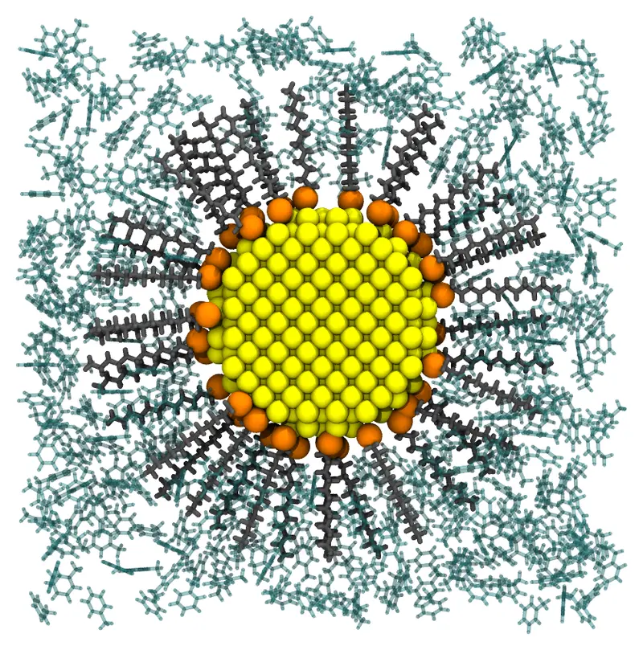
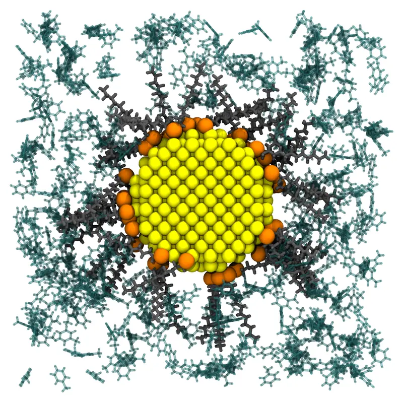

# Gold nanoparticle in toluene

A gold nanoparticle protected by a monolayer of dodecanethiolates, in toluene: the
nanoparticles of the Brust–Schiffrin synthesis, soluble in organic solvents. The gold
core is a fixed molecule, the ligands are bound to its surface by their sulfur atoms, with
their chains pointing outwards, and the solvent fills the cell around the particle and the
space between the chains.



*A slab of 16 Å through the center of the system: the gold core (yellow), the sulfur
atoms of the ligands (orange), their chains (gray), and toluene (green).*

Files: [`gold.pdb`](files/gold_nanoparticle/gold.pdb),
[`ddt.pdb`](files/gold_nanoparticle/ddt.pdb),
[`toluene.pdb`](files/gold_nanoparticle/toluene.pdb), and the input file
[`gold_nanoparticle.inp`](files/gold_nanoparticle/gold_nanoparticle.inp).

## The structures

- **The gold core**: the atoms of the face-centered cubic lattice of gold (a = 4.078 Å)
  within 15 Å of an atom: a sphere of 3 nm, with 887 atoms, centered at the origin. It
  was built by the script `gold.jl`:

```@raw html
<details><summary>The script <code>gold.jl</code> (click to expand)</summary>
```
```@eval
Main.input_file("files/gold_nanoparticle/gold.jl")
```
```@raw html
</details><br>
```

- **The ligand**: dodecanethiolate, C₁₂H₂₅S⁻, in its extended (all-trans) conformation,
  15.3 Å from the sulfur atom (atom 1) to the last carbon atom (atom 13), built by
  [Open Babel](https://openbabel.org) from its SMILES
  (`obabel -:"[S-]CCCCCCCCCCCC" -O ddt.pdb --gen3d -h`), as was toluene
  (`obabel -:"Cc1ccccc1" -O toluene.pdb --gen3d -h`).

## The numbers of molecules

- **The ligands**: thiolates on flat gold form a monolayer with one molecule per 21.4 Ų
  (the √3 × √3 R30° structure on Au(111)). On the 2830 Ų of the surface of the core, that is
  132 ligands. On the curved surfaces of small nanoparticles, the ligands are denser, since
  their chains fan out: the number can be raised for smaller cores.
- **The solvent**: the cell is a cube of 80 Å, periodic, centered at the origin. The
  solvent fills the cell beyond the layer of sulfur atoms (18 Å from the center), whose
  volume, given by [`free_volume`](@ref) (see [Volume estimates](@ref)), is 487000 ų.
  The ligands take 52000 ų of it: 132 × 396 ų, the volume of a molecule of
  dodecanethiol in the liquid (0.845 g/mL). The remaining 435000 ų holds 2465 molecules
  of toluene (0.867 g/mL).

## Command line

```@raw html
<details><summary>The input file <code>gold_nanoparticle.inp</code> (click to expand)</summary>
```
```@eval
Main.input_file("files/gold_nanoparticle/gold_nanoparticle.inp")
```
```@raw html
</details><br>
```

The ligands have constraints on the whole molecule and on two of their atoms (see
[Structure blocks](../input_files/structure_blocks.md)):

- the whole molecule outside the sphere of 16 Å, the core and 1 Å beyond its atoms;
- the sulfur atom (`atoms 1`) inside the sphere of 17.5 Å: with the constraint of the
  whole molecule, in a shell from 1 to 2.5 Å above the surface of the core;
- the last carbon atom (`atoms 13`) outside the sphere of 25 Å, so that the chains point
  outwards. The chains are 15.3 Å long, so their ends could reach 32.5 Å: the constraint
  is permissive, and the chains can tilt.

The solvent is kept outside the sphere of 18 Å: beyond the sulfur atoms, so that it does
not reach the surface of the gold between them. It fills the rest of the cell, between
the chains too.

### Check the initial placement first

Uncomment the `check_initial_placement` line of the input file, and run it as below
(see [Checking the initial placement](@ref check_initial_placement)): the initial
placement, written to the output file in a fraction of a second, has the sulfur atoms on
the surface and the chains around the core, but the chains are still tilted and
crowded:



When it looks like this, comment the line again, and run the packing.

### Packing

```
packmol gold_nanoparticle.inp
```

The packing (42900 atoms) takes about 3 seconds. All the ligands end with their sulfur
atoms 16 to 17.5 Å from the center, and their chains point outwards, at 15° from the
radial direction on average, with their ends at 31 to 33 Å from the center.

## Julia

```julia
using Packmol

gold = structure_type("gold.pdb"; number = 1, fixed = ([0., 0., 0.], [0., 0., 0.]))
ligands = structure_type("ddt.pdb";
    number = 132,
    constraints = [OutsideSphere([0., 0., 0.], 16.)],
    atom_constraints = [
        [1] => InsideSphere([0., 0., 0.], 17.5),   # the sulfur atom
        [13] => OutsideSphere([0., 0., 0.], 25.),  # the end of the chain
    ],
)
toluene = structure_type("toluene.pdb";
    number = 2465,
    constraints = [OutsideSphere([0., 0., 0.], 18.)],
)
system = PackmolSystem([gold, ligands, toluene];
    output = "gold_nanoparticle.pdb",
    tolerance = 2.0,
    unitcell = [80. 0. 0.; 0. 80. 0.; 0. 0. 80.], # centered at the origin
    # check_initial_placement = true, # uncomment to only place the molecules
)
packmol(system)
```

`free_volume(system)` gives the volume available to the solvent.
