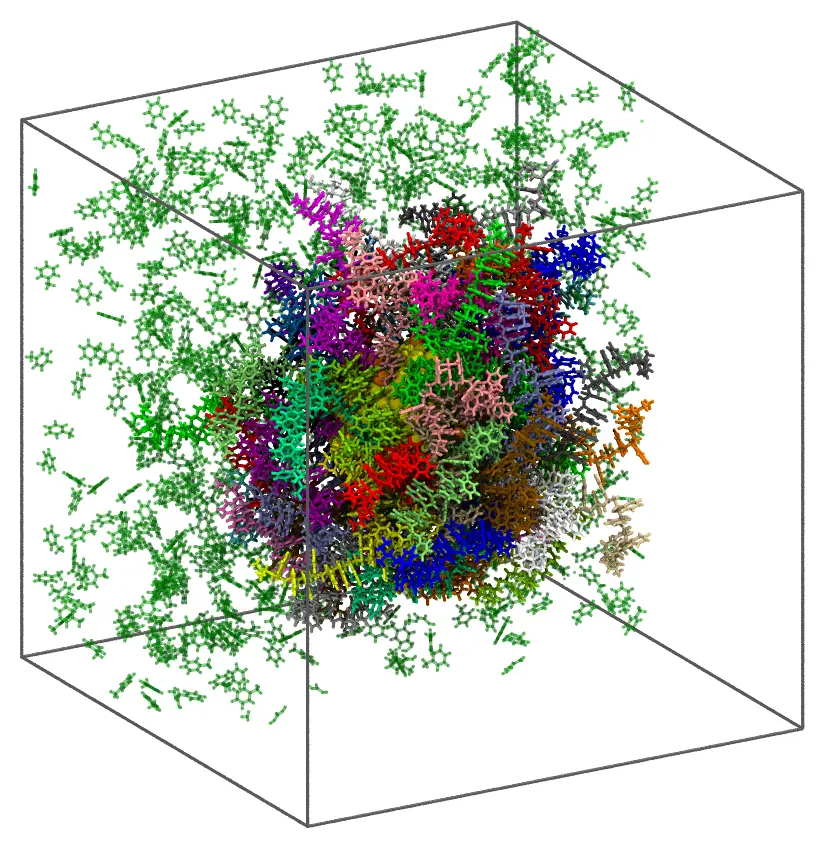
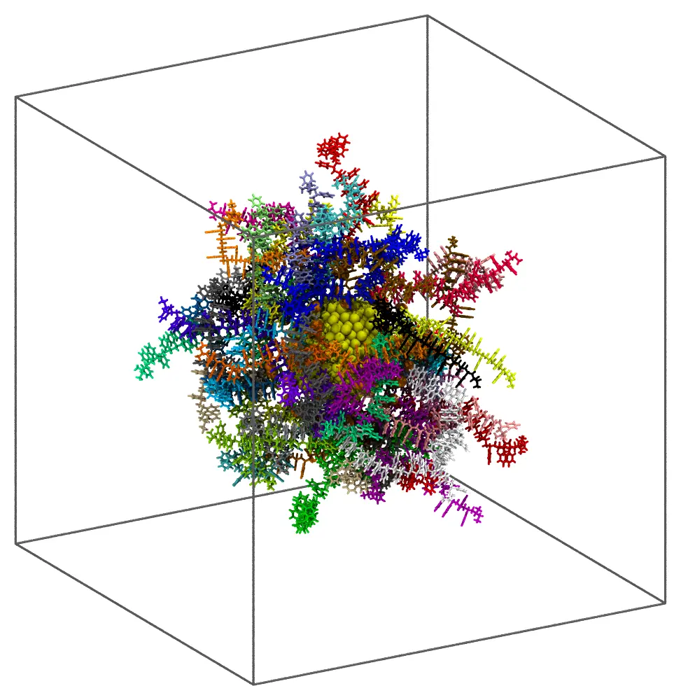
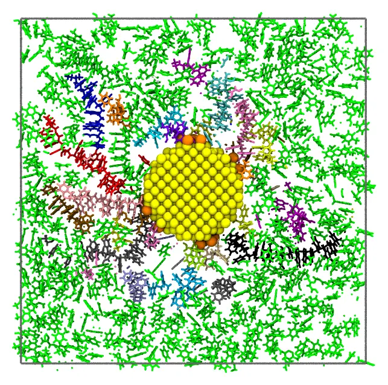

# Polymer-capped gold nanoparticle

A gold nanoparticle capped by thiol-terminated polystyrene, in toluene, with all atoms:
a gold core, fixed, with 57 chains of polystyrene bound to its surface by their sulfur
atoms, and the toluene around them and between the chains. The chains are flexible
([Polymers](@ref)), and too dense near the surface of the core to pack from a random
placement: the system is packed at half its density, and compressed around the fixed
core ([Packing by compression](@ref)).



*The gold core (yellow), the chains, each in a color, and one in every five toluene
molecules (green) of the half of the cell behind the particle.*

Files: [`gold.pdb`](files/gold_polymer/gold.pdb),
[`polystyrene.pdb`](files/gold_polymer/polystyrene.pdb) (the conformations of the
chains), [`toluene.pdb`](files/gold_polymer/toluene.pdb), and the input file
[`gold_polymer.inp`](files/gold_polymer/gold_polymer.inp).

## The structures

- **The gold core**: the core of the tutorial [Gold nanoparticle in toluene](@ref), a
  sphere of 3 nm of the face-centered cubic lattice of gold, with 887 atoms.
- **The chains**: sec-butyl–[CH₂–CH(C₆H₅)]₂₀–CH₂CH₂–S⁻, polystyrene of 20 units made by
  anionic polymerization (initiated by sec-butyllithium) and end-capped with ethylene
  sulfide, a thiol-terminated polystyrene of 2200 g/mol, with 340 atoms. `polystyrene.pdb`
  holds 10 conformations of the chain (one model each), atactic random coils, with radii
  of gyration between 10.7 and 13.7 Å, and 23 to 44 Å from the sulfur atom to the end of
  the chain.
- **The solvent**: toluene, as in [Gold nanoparticle in toluene](@ref).

!!! note "Conformations of the chains"
    Generating the conformations is not the job of Packmol, but of the user: they should
    come from a simulation of the free chain, for example a short molecular dynamics
    simulation at high temperature. The conformations of `polystyrene.pdb` were built by
    [`build_polystyrene.jl`](files/gold_polymer/build_polystyrene.jl), a proof of concept
    only: self-avoiding random walks of the backbone in the trans and gauche states, with
    the phenyl groups on random sides of it, with no force field behind them.

    Several conformations, rather than one, also matter for the simulation itself,
    independently of the packing: the chains start from different conformations, and
    the results depend less on that of a single one.

## The chains as polymers

The atoms of the chain are in the order of its backbone, from the sulfur atom, in groups
that are the rigid monomers of the polymer: S–CH₂ (4 atoms) and CH₂ (3), then 20 times
CH(C₆H₅) (13) and CH₂ (3), and the sec-butyl group (13). Each group starts with its
backbone carbon atom (the S–CH₂ group, with the sulfur atom), followed by its
substituents. Each group is bonded to the next one by their backbone carbon atoms, and
turns about that bond:

```
  bond_distance 1.9   # the bonds: the atoms closer than 1.9 Å
  repeat 20
    monomer 13        # CH(C6H5)
      rotatable 1 1   # the bond of atom 1 to atom 1 of the next group
    monomer 3         # CH2
      rotatable 1 1
  end repeat
```

`rotatable 1 1` stands for the links that keep the length of the bond and its angles,
at their values in each conformation: the bond, and the bonds of its atoms to their
neighbors in their groups (five links: two hydrogen atoms, or a hydrogen atom and the
phenyl ring, on each side), and leaves the groups free to turn about the bond: every bond
of the backbone rotates (see [Polymers](@ref)). The bonds are computed from the distances
(`bond_distance`), since the file has no CONECT records. A chain is 43 rigid groups, and
the pairs of atoms of different groups up to three bonds apart are left out of the
distances.

## The numbers of molecules

- **The chains**: short thiol-terminated polymers bind to gold at one to a few chains
  per nm². Here, 2 chains per nm² of the 28.3 nm² of the surface of the core: 57 chains.
- **The solvent**: the cell is a cube of 110 Å, periodic, centered at the origin. The
  toluene fills the cell beyond the layer of sulfur atoms (18 Å from the center), whose
  volume, given by [`free_volume`](@ref) (see [Volume estimates](@ref)), is 1.307 × 10⁶ ų.
  The chains take 198000 ų of it: 57 × 3480 ų, the volume of a chain at the density
  of polystyrene (1.05 g/mL). The remaining 1.109 × 10⁶ ų holds 6280 molecules of toluene
  (0.867 g/mL).

The system has 114,467 atoms.

## Capping the nanoparticle

```@raw html
<details><summary>The input file <code>gold_polymer.inp</code> (click to expand)</summary>
```
```@eval
Main.input_file("files/gold_polymer/gold_polymer.inp")
```
```@raw html
</details><br>
```

The chains are bound to the core as the ligands of [Gold nanoparticle in
toluene](@ref): the whole chain outside the sphere of 16 Å (the core and 1 Å beyond its
atoms), and its sulfur atom (`atoms 1`) inside the sphere of 17.5 Å, in a shell from 1
to 2.5 Å above the surface of the core. Nothing orients the chains: they are coils, which
the crowding near the surface stretches outwards. The toluene is kept beyond the sulfur
atoms (outside the sphere of 18 Å), and fills the rest of the cell, between the chains
too.

Packed from a random placement, the system does not converge: near the surface of the
core, the chains jam (in 500 loops, with the chains rigid and then flexible, the
function stalls at about 25, with the chains overlapping each other). With
`use_compression 0.5`, the system is first packed at half its density: the constraints
and the cell are expanded by 2^(1/3), and the system packed there (as rigid molecules,
then with the chains released). The gold core is fixed, and is scaled with the geometry
(the coordinates of its atoms and their radii): the shell of the sulfur atoms, placed
relative to the core, stays on its surface, expanded and compressed with it, in steps,
back to the geometry of the input file.

### Check the initial placement first

Uncomment the `check_initial_placement` line of the input file, and run it (see
[Checking the initial placement](@ref check_initial_placement)): the initial placement
is that of the expanded geometry, with the chains as rigid molecules, before any
packing:



*The initial placement, in the expanded cell: the gold core and the chains (the toluene
is not shown).*

When it looks like this, comment the line again, and run the packing.

### Packing

```
packmol gold_polymer.inp
```

The packing at half the density takes about 2 minutes, and the compression about 60
steps, in 5 to 6 minutes, with 14 threads:

```
  Compression step    1: density   58.32% of the target, not converged (9.9 s)
  ...
  Compression step   58: density  100.00% of the target, converged (7.7 s)
  Compressed to the density of the input in 58 steps (330.4 s).
```

All the sulfur atoms end 16 to 17.5 Å from the center, and the bonds of the chains are
kept to 0.08 Å. The ends of the chains are 18 to 56 Å from the center (42 Å on average):
the chains stretch out from the surface, a brush (with a few folded back).



*A slab of 10 Å through the middle of the cell: the gold core, the sulfur atoms
(orange) on its surface, the chains, and the toluene between them and around them.*

## Julia script

```julia
using Packmol

origin = [0., 0., 0.]

gold = structure_type("gold.pdb";
    number = 1,
    center = :geometric,
    fixed = (origin, origin),
)

# The groups of the chain, each turning about the bond of its
# backbone carbon atom (atom 1, or atom 2 of S-CH2) to that of the next
sequence = [
    1 => [
        monomer(4; rotatable = [(2, 1)]), # S-CH2
        monomer(3; rotatable = [(1, 1)]), # CH2
    ],
    20 => [
        monomer(13; rotatable = [(1, 1)]), # CH(C6H5)
        monomer(3; rotatable = [(1, 1)]),  # CH2
    ],
    1 => [monomer(13)],                    # sec-butyl
]
chains = polymer_structure("polystyrene.pdb";
    number = 57,
    sequence,
    bond_distance = 1.9, # the bonds: the atoms closer than 1.9 Å
    constraints = [OutsideSphere(origin, 16.)],
    atom_constraints = [[1] => InsideSphere(origin, 17.5)], # the sulfur atom
)

toluene = structure_type("toluene.pdb";
    number = 6280,
    constraints = [OutsideSphere(origin, 18.)],
)

system = PackmolSystem([gold, chains, toluene];
    output = "gold_polymer.pdb",
    tolerance = 2.0,
    unitcell = [110. 0. 0.; 0. 110. 0.; 0. 0. 110.], # centered at the origin
    use_compression = 0.5,
    # check_initial_placement = true,
)
packmol(system)
```
