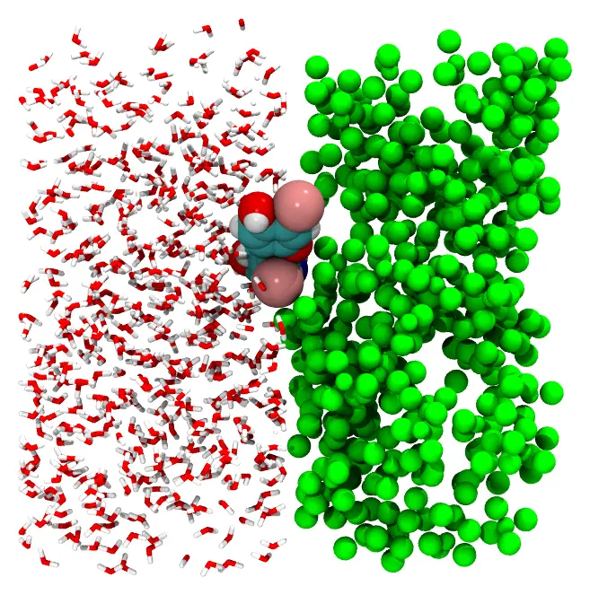
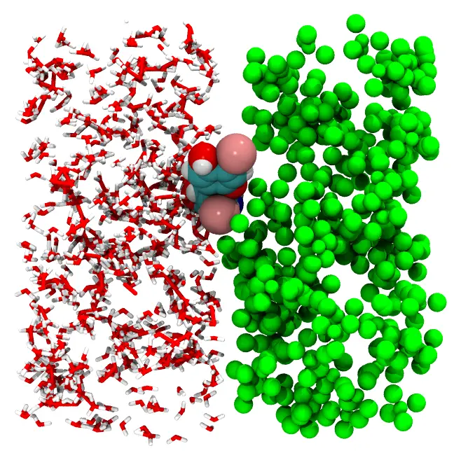

# Water–chloroform interface

A thyroid hormone at the interface between water and chloroform. The two solvents fill
adjacent boxes, which share the plane `x = 0`, and the hormone is fixed at a given
position and orientation on that plane. The files are in the XYZ format.



Files: [`water.xyz`](https://m3g.github.io/packmol/examples/water.xyz),
[`chlor.xyz`](https://m3g.github.io/packmol/examples/chlor.xyz),
[`t3.xyz`](https://m3g.github.io/packmol/examples/t3.xyz) and the input file
[`interface.inp`](https://m3g.github.io/packmol/examples/interface-comment.inp).

## Command line

The input file:

```
#
# Thyroid hormone in an interface of water and chloroform
#

# All atoms from different molecules will be at least 2.0 Angstroms apart
# from each other in the solution.

tolerance 2.0

# The files are in the simple xyz format

filetype xyz

# The name of the output file.

output interface.xyz

# Water molecules will be inside a box that has 39 A of length in the y
# and z directions and 20 A of length in the x direction. Waters will be
# put in the box defined by the minimum x, y, and z coordinates -20. 0.
# 0. and maximum x, y and z coordinates 0. 39. 39.

structure water.xyz
  number 1019
  inside box -20. 0. 0. 0. 39. 39.
end structure

# Chloroform molecules will be in a box that has the same length as
# the water box in the y and z directions. However, this box starts at
# x = 0., in such a way that there will be an interface in that plane.

structure chlor.xyz
  number 199
  inside box 0. 0. 0. 21. 39. 39.
end structure

# The hormone molecule will be fixed at the interface, in the center of
# the box, rotated in such a way that it lies parallel to the
# interface. The first three numbers are the position where the center
# of mass of the hormone will be fixed, and the last three numbers
# are its rotation.

structure t3.xyz
  centerofmass
  fixed 0. 20. 20. 1.57 1.57 1.57
end structure
```

### Check the initial approximation first

For a system with the two solvents and the fixed hormone, first check that the constraints place the molecules where
intended. Add the `check` keyword to the input file:

```
check
```

and run it as below. Packmol then only builds the initial approximation, in a fraction
of a second: each molecule is placed in its region, satisfying the constraints, but the
molecules may still overlap. It is written to the output file (`interface.xyz`). Look at it in
a molecular visualization program:



*Water (left) and chloroform (right) in the initial approximation: the molecules are in their boxes, but may overlap. The hormone is fixed at the interface.*

When the molecules are where they should be, remove `check`, and run the packing.
If the constraints cannot be satisfied at all, even without the distances between the
molecules, Packmol stops after the initial approximation with an error (unless the
`continue_failed_initial_packing` keyword is set): that is almost always a sign of
wrong constraints.

### Packing

Run it with:

```
packmol interface.inp
```

The packed system is written to `interface.xyz`.

The `fixed` keyword places a molecule instead of packing it: the first three numbers
are a position, and the last three are rotation angles (in radians) applied to the
coordinates of the file. With `centerofmass`, the molecule is rotated about its center
of mass, which is then placed at the given position; without it, the rotation is about
the origin of the coordinates of the file.

## Julia

```julia
using Packmol

water = structure_type("water.xyz";
    number = 1019,
    constraints = [InsideBox([-20., 0., 0.], [0., 39., 39.])],
)
chloroform = structure_type("chlor.xyz";
    number = 199,
    constraints = [InsideBox([0., 0., 0.], [21., 39., 39.])],
)
hormone = structure_type("t3.xyz";
    number = 1,
    fixed = ([0., 20., 20.], [1.57, 1.57, 1.57]),
    center = :mass,
)

system = PackmolSystem([water, chloroform, hormone]; output = "interface.xyz", tolerance = 2.0)
packmol(system)
```

As with the input file, check the initial approximation first, by building the system
with `check = true` (`PackmolSystem(...; check = true)`): `packmol(system)` then writes
the initial approximation to the output file, and stops.

`fixed` is a `(position, angles)` pair, and `center = :mass` is the input's
`centerofmass` (`center = :geometric` is `center`). The format of each file follows its
extension (`.xyz`, `.pdb`, `.cif`), so `filetype` is not needed.
