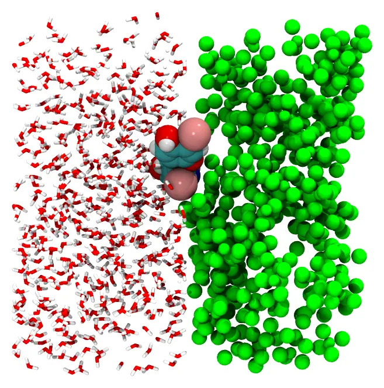
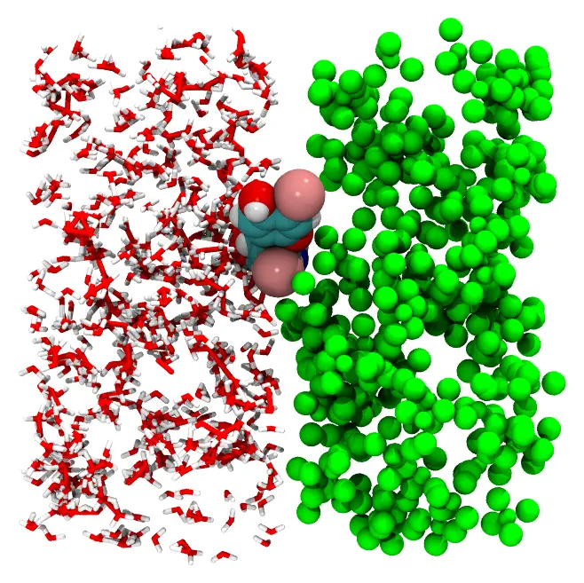

# Water–chloroform interface

A thyroid hormone at the interface between water and chloroform. The two solvents fill
adjacent boxes, which share the plane `x = 0`, and the hormone is fixed at a given
position and orientation on that plane. The files are in the XYZ format.



Files: [`water.xyz`](files/interface/water.xyz), [`chlor.xyz`](files/interface/chlor.xyz),
[`t3.xyz`](files/interface/t3.xyz) and the input file
[`interface.inp`](files/interface/interface.inp).

## Command line

```@raw html
<details><summary>The input file <code>interface.inp</code> (click to expand)</summary>
```
```@eval
Main.input_file("files/interface/interface.inp")
```
```@raw html
</details><br>
```

### Check the initial placement first

Uncomment the `check_initial_placement` line of the input file, and run it as below
(see [Checking the initial placement](@ref check_initial_placement)): the initial
placement of the molecules is written to the output file (`interface.xyz`):



*Water (left) and chloroform (right) in the initial approximation: the molecules are in their boxes, but may overlap. The hormone is fixed at the interface.*

Then comment the line again, and run the packing.

### Packing

Run it with:

```
packmol interface.inp
```

The packed system is written to `interface.xyz`.

The `fixed` keyword places a molecule instead of packing it: the first three numbers
are a position, and the last three are rotation angles (in radians) applied to the
coordinates of the file. With `centerofmass`, the molecule is rotated about its center
of mass, which is then placed at the given position; without it, the rotation is about
the origin of the coordinates of the file.

## Julia

```julia
using Packmol

water = structure_type("water.xyz";
    number = 1019,
    constraints = [InsideBox([-20., 0., 0.], [0., 39., 39.])],
)
chloroform = structure_type("chlor.xyz";
    number = 199,
    constraints = [InsideBox([0., 0., 0.], [21., 39., 39.])],
)
hormone = structure_type("t3.xyz";
    number = 1,
    fixed = ([0., 20., 20.], [1.57, 1.57, 1.57]),
    center = :mass,
)

system = PackmolSystem([water, chloroform, hormone];
    output = "interface.xyz",
    tolerance = 2.0,
    # check_initial_placement = true, # uncomment to only place the molecules
)
packmol(system)
```

As with the input file, check the initial placement first, with
`check_initial_placement = true` (commented in the code above).

`fixed` is a `(position, angles)` pair, and `center = :mass` is the input's
`centerofmass` (`center = :geometric` is `center`). The format of each file follows its
extension (`.xyz`, `.pdb`, `.cif`), so `filetype` is not needed.
