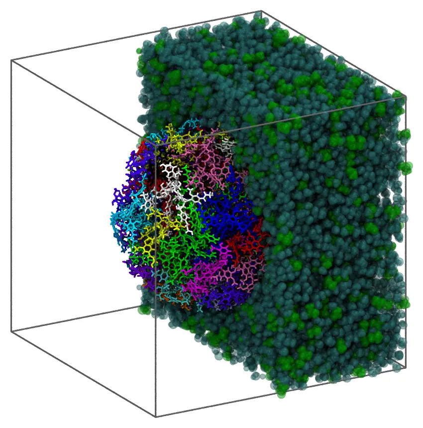
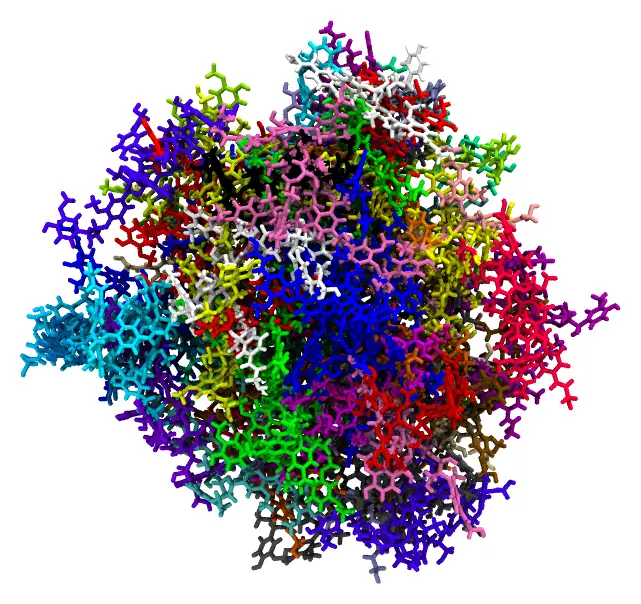
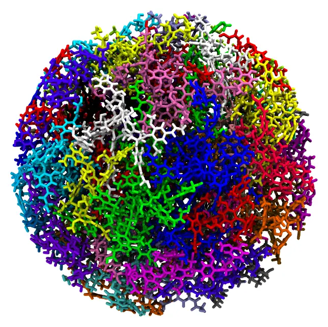
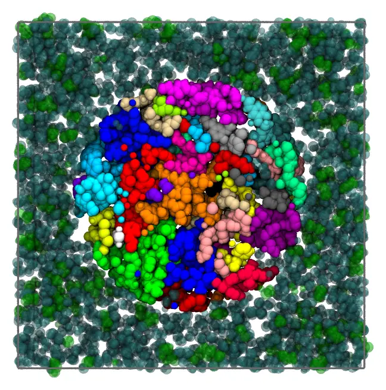
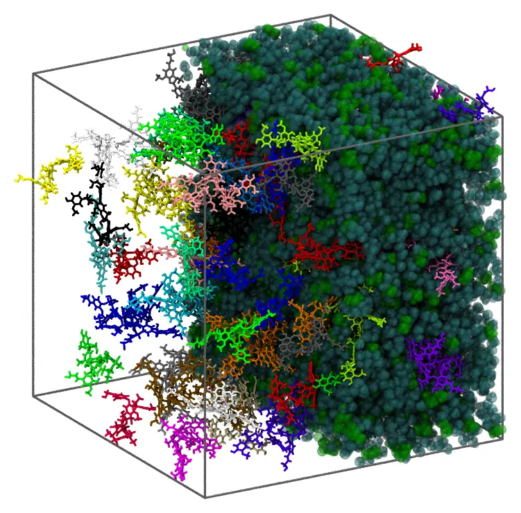
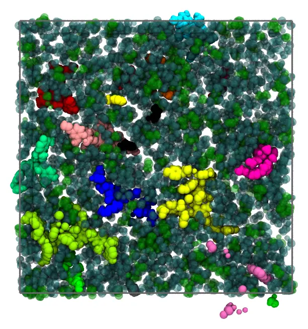

# Lignin particle in acetone and water

A particle of lignin in a mixture of acetone and water, with all atoms: 70 oligomers of
spruce lignin packed in a dense sphere, and the solvent around it. The oligomers are
flexible, turning about all their rotatable bonds, which are found from their bonds
(`rotatable all`, see [Rotatable bonds](@ref)), and the particle is too dense to pack from
a random placement: it is packed at half its density, and compressed
([Packing by compression](@ref)). The solvent is then packed around the particle, fixed.
The same molecules are also packed dispersed in the solvent.



*The lignin particle, each oligomer in a color, and the acetone (green) and the water
(cyan) of the half of the cell beyond a cut through the middle of the particle.*

Files: the oligomers, [`lignin_L3.pdb`](files/lignin/lignin_L3.pdb),
[`lignin_L5.pdb`](files/lignin/lignin_L5.pdb),
[`lignin_L22.pdb`](files/lignin/lignin_L22.pdb),
[`lignin_L28.pdb`](files/lignin/lignin_L28.pdb),
[`lignin_L40.pdb`](files/lignin/lignin_L40.pdb),
[`lignin_L41.pdb`](files/lignin/lignin_L41.pdb),
[`lignin_L63.pdb`](files/lignin/lignin_L63.pdb),
[`lignin_L67.pdb`](files/lignin/lignin_L67.pdb),
[`lignin_L86.pdb`](files/lignin/lignin_L86.pdb) and
[`lignin_L90.pdb`](files/lignin/lignin_L90.pdb);
[`acetone.pdb`](files/lignin/acetone.pdb), [`water.pdb`](files/lignin/water.pdb), and the
input files [`particle.inp`](files/lignin/particle.inp),
[`solvation.inp`](files/lignin/solvation.inp) and
[`dispersed.inp`](files/lignin/dispersed.inp).

## The structures

- **The lignin**: oligomers of spruce lignin (a softwood lignin, mostly of guaiacyl
  units), built by
  [LigninBuilder](https://github.com/jvermaas/LigninBuilder) (Vermaas et al., *ACS
  Sustainable Chem. Eng.* 7, 3443, 2019) from its library of spruce lignin: 100
  oligomers, with the linkages of natural lignin (β-O-4, β-5, β-β, 5-5, ...), from 85 to
  5949 atoms. Ten of the 68 oligomers of 120 to 400 atoms (one in seven, by size) are
  used here: 6 to 16 units, 141 to 375 atoms, 1069 to 2841 g/mol. Each comes with its
  bonds (`CONECT` records).
- **The solvent**: acetone and water (TIP3P), all atoms.

!!! note "Building the oligomers"
    Building the molecules is not the job of Packmol. The oligomers were built and
    minimized with LigninBuilder and NAMD (its protocol), by
    [`build_lignin.tcl`](files/lignin/build_lignin.tcl) (a VMD script), and written with
    their bonds. The structures of LigninBuilder have clashes and stretched bonds before
    the minimization: the bonds that close the rings of some linkages are part of rigid
    fragments, and Packmol keeps their geometry as it is.

## The rotatable bonds

The oligomers are branched, with rings in their linkages, and a different molecule each:
the rotatable bonds are found by `rotatable all`, from the bonds of the `CONECT` records
of the files. These are the bonds not in rings between heavy atoms with other heavy
atoms bonded to them, and single for sure (see [Rotatable bonds](@ref)): the bonds of the
linkages (Cα–Cβ, Cβ–O4, O4–C4, ...), the bonds of the side chains and of the methoxy
groups to the rings, and the 5-5 bonds between rings. The ring–Cα bonds of the
coniferyl alcohol end groups (Cα=Cβ) do not turn, as the double bonds themselves. Each
oligomer has 24 to 72 rotatable bonds, which cut it into rigid fragments of 1 to 11
heavy atoms (with their hydrogens):

```
structure lignin_L5.pdb
  number 7
  rotatable all
  inside sphere 0. 0. 0. 33.
end structure
```

When packing, the number of bonds found is printed for each oligomer:

```
  Rotatable bonds of lignin_L5.pdb: 28 found
```

!!! warning "Finding the rotatable bonds requires all the hydrogens"
    Whether a bond is single is deduced from the numbers of bonds of its atoms, which
    requires the structure with all its hydrogen atoms (as here).

## The numbers of molecules

- **The particle**: 7 copies of each of the 10 oligomers, 70 molecules of 116,600 g/mol
  together, 15,463 atoms, in a sphere of 33 Å: 1.30 g/cm³, the density of solid lignin.
- **The solvent**: acetone and water, 30:70 by volume, in a periodic cube of 100 Å. The
  volume left by the particle, 849,500 ų, holds 2073 molecules of acetone (0.785 g/mL)
  and 19,877 of water (1.0 g/mL), at their densities as pure liquids (the excess volume
  of the mixture is neglected).

The system has 95,824 atoms.

## The lignin particle

```@raw html
<details><summary>The input file <code>particle.inp</code> (click to expand)</summary>
```
```@eval
Main.input_file("files/lignin/particle.inp")
```
```@raw html
</details><br>
```

The particle is too dense to pack from a random placement. With `use_compression 0.5`,
it is first packed at half its density, in a sphere of 41.6 Å (33 × 2^(1/3)), as rigid
molecules and then flexible, and then compressed to the sphere of 33 Å, in steps. At
this density, some steps do not converge: the packing is then relaxed at a lower density
and compressed again from there (see [Packing by compression](@ref)).

### Check the initial placement first

Uncomment the `check_initial_placement` line of the input file, and run it (see
[Checking the initial placement](@ref check_initial_placement)): the initial placement
is that of the expanded sphere, with the oligomers as rigid molecules:



*The initial placement of the oligomers, in the expanded sphere.*

When it looks like this, comment the line again, and run the packing.

### Packing

```
packmol particle.inp
```

The packing at half the density, and then the compression, in 15 to 60 steps, take
about one minute with 14 threads:

```
  Compression step    1: density   58.32% of the target, converged (0.3 s)
  ...
  Compressed to the density of the input in 36 steps (67.3 s).
```



*The lignin particle: 70 oligomers, each in a color.*

The bonds are kept to 0.09 Å.

## The solvent

```@raw html
<details><summary>The input file <code>solvation.inp</code> (click to expand)</summary>
```
```@eval
Main.input_file("files/lignin/solvation.inp")
```
```@raw html
</details><br>
```

The particle, `particle.pdb`, is a single structure, fixed where it was packed (with
`fixed 0. 0. 0. 0. 0. 0.`, its coordinates are kept as they are), at the center of the
periodic cube. The acetone and the water fill the cell around it, with no constraints:

```
packmol solvation.inp
```

It takes a few seconds.



*A slab of 10 Å through the middle of the cell: the atoms of the oligomers (each in a
color), of the acetone (green) and of the water (cyan).*

## The dispersed lignin

The same molecules can be packed dispersed in the solvent: the 70 oligomers, flexible,
and the acetone and the water, all in the periodic cube, with no constraints. At this
concentration (194 mg/mL of lignin), they pack directly, with no compression:

```@raw html
<details><summary>The input file <code>dispersed.inp</code> (click to expand)</summary>
```
```@eval
Main.input_file("files/lignin/dispersed.inp")
```
```@raw html
</details><br>
```

```
packmol dispersed.inp
```

In this single run, the oligomers are first packed as rigid molecules, with the solvent,
and then released and packed flexible. It takes from a few seconds to about a minute
(when the packing of the rigid oligomers does not converge, it runs for its 500 loops
before they are released).



*The oligomers dispersed in the solvent, of which the half of the cell beyond a cut
through the middle is shown. The oligomers are whole, placed in the cell by their centers:
some cross its faces.*



*A slab of 10 Å through the middle of the cell.*

## Julia script

```julia
using Packmol

origin = [0., 0., 0.]

# The particle: 7 copies of each oligomer, all their rotatable bonds turning
names = ["L3", "L5", "L22", "L28", "L40", "L41", "L63", "L67", "L86", "L90"]
oligomers = [
    flexible_structure("lignin_$name.pdb";
        number = 7,
        rotatable = :all,
        constraints = [InsideSphere(origin, 33.)],
    )
    for name in names
]
particle = PackmolSystem(oligomers;
    output = "particle.pdb",
    tolerance = 2.0,
    use_compression = 0.5,
    # check_initial_placement = true,
)
packmol(particle)

# The solvent, around the particle, fixed
lignin = structure_type("particle.pdb";
    number = 1,
    fixed = (origin, origin),
)
water = structure_type("water.pdb"; number = 19877)
acetone = structure_type("acetone.pdb"; number = 2073)
system = PackmolSystem([lignin, water, acetone];
    output = "lignin.pdb",
    tolerance = 2.0,
    unitcell = [100. 0. 0.; 0. 100. 0.; 0. 0. 100.], # centered at the origin
)
packmol(system)

# The lignin dispersed in the solvent
dispersed_oligomers = [
    flexible_structure("lignin_$name.pdb";
        number = 7,
        rotatable = :all,
    )
    for name in names
]
dispersed = PackmolSystem([dispersed_oligomers; water; acetone];
    output = "dispersed.pdb",
    tolerance = 2.0,
    unitcell = [100. 0. 0.; 0. 100. 0.; 0. 0. 100.], # centered at the origin
)
packmol(dispersed)
```
