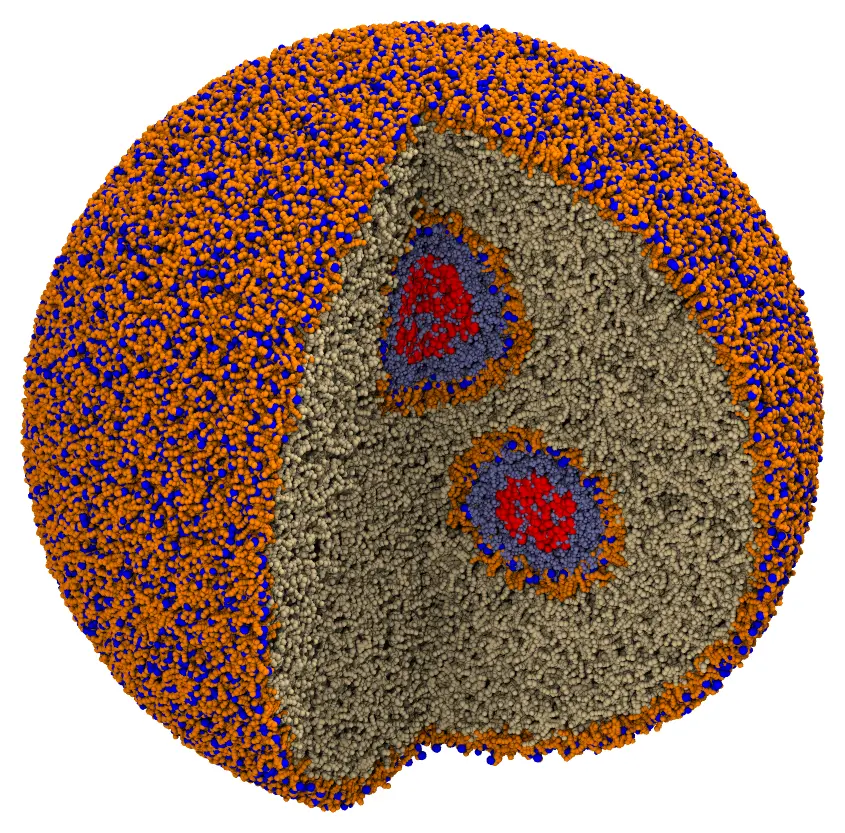
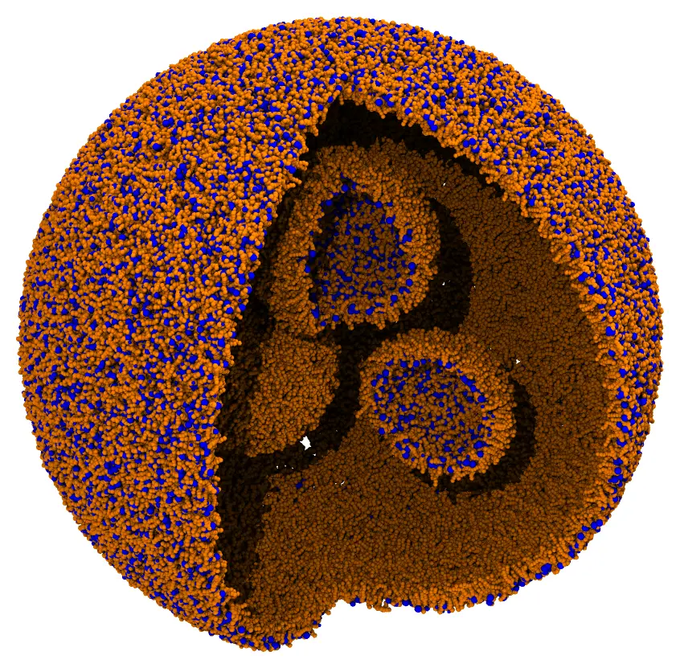
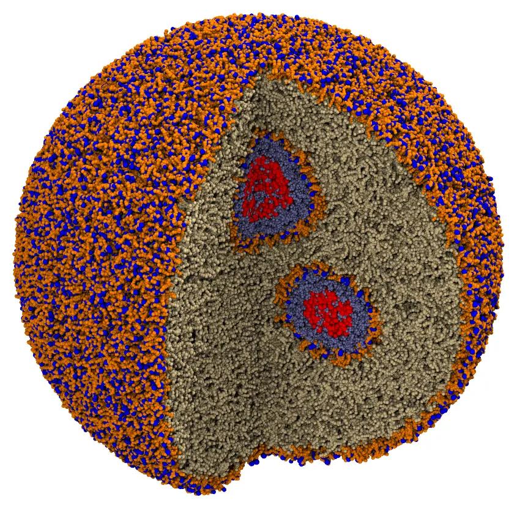

# Lipid nanoparticle (designed with an AI agent)

A lipid nanoparticle (LNP) of 80 nm, such as those that carry mRNA vaccines, in a
coarse-grained model ([SIRAH](https://www.sirahff.com/)): an outer monolayer of lipids, a
lipid phase inside it, and three water compartments bounded by monolayers, each with a
piece of RNA, in water, in a truncated octahedron periodic cell with 860 Å between opposite
hexagonal faces. The system has 5.6 million particles and 887 thousand molecules.

The system was designed by an AI agent (Claude Code) from an illustration of an LNP and a
few sentences of description, in a conversation of a few steps. This page shows that
conversation, and then the system, built as in the other tutorials. It is a proof of
concept: the composition of the lipid phase and the RNA are placeholders, not a model of
a real LNP.



*The nanoparticle with a quarter cut out: the heads (blue) and the chains (orange) of the
lipids of the monolayers, the lipid phase (tan), and, in the compartments, water (light
blue) and RNA (red). The water outside is shown behind the particle, up to the faces of
the periodic cell.*

The files are the `packmol_lnp` set of
[MolSimTestFiles](https://github.com/m3g/MolSimTestFiles): download and extract
[packmol_lnp.tar.gz](https://github.com/m3g/MolSimTestFiles/releases/download/packmol_lnp-v1/packmol_lnp.tar.gz)
(0.2 MB), which contains the two input files, `monolayers.inp` and `lnp.inp`, and the
structures: `popc.pdb`, `pope.pdb` and `pops.pdb` (the lipids) and `wt4.pdb` (water), those
of the [Zika virion](zika.md) tutorial, and `rna1.cif`, `rna2.cif` and `rna3.cif`, the
pieces of RNA.

## From a sketch to a system

The starting point was an illustration of an LNP: a sphere with a lipid shell, and, inside it, smaller spheres
bounded by lipids, with RNA and water. The request to the agent was (the prompts are
quoted with small corrections):

```text
What I want now is to try to build this system [the illustration]. The liposome
is about 80 nm wide, and inside there are three smaller ones. Inside each one
there's RNA and water; in the middle of the membranes there are lipids. I don't
know the composition. Outside there should be water, in an octahedron. The
system should be built coarse-grained. Can you evaluate that?

The exact details are not critical: this would be a proof of concept.
```

The agent read the illustration, proposed a geometry (the sizes and the positions of the
compartments, the shells of the lipids), and estimated the numbers of molecules. The
design was then corrected and simplified in a few exchanges:

- **The molecules.** The structures of the molecules are for the user to provide: an
  agent can build rough models, but not ones fit for a simulation. Here, the lipids and
  the water of SIRAH of the [Zika virion](zika.md) tutorial were used: POPC, POPE and
  POPS, 60:30:10, and the WT4 water. Before building anything, the agent confirmed with
  the user how the lipids are oriented by the constraints: the head bead (bead 1) and the
  end of a chain (bead 16, or 17 in POPS), from the structure files and the input of the
  Zika virion.
- **The layers.** The layers of the illustration are monolayers, with the chains of the
  lipids pointing to the lipid phase between them: heads outwards in the outer layer,
  inwards (towards the water) in the compartments.
- **The geometry first.** Only the four monolayers were packed first (`monolayers.inp`,
  half a minute), to check the geometry:

  

  *The four monolayers, with a quarter cut out.*

- **The rest.** Then:

  ```text
  Fill the inner part with POPC, the inner spheres with WT4 and a piece of mRNA
  that fits in those spaces, and an octahedron of WT4 outside.
  ```

  The agent wrote a script for the pieces of RNA: compact chains of 3 beads per
  nucleotide, of 1500, 1000 and 700 nucleotides, with the size that fits in each
  compartment (placeholders: a real structure of a coarse-grained mRNA would replace them),
  fixed at the centers of the compartments.
- **The scale of the radii.** The lipids of the monolayers start the packing with their
  radii scaled by 5 (`radscale 5.0` in their structure blocks; the default for molecules
  of up to 20 beads is 1), so that they spread over their surfaces before they settle
  (see [Structure blocks](@ref)). The POPC of the lipid phase was first given the same
  scale, and the first loop of the packing did not finish in 10 minutes, most likely
  because, inflated five-fold, it does not fit in its region, which is enclosed by the
  monolayers. The
  agent proposed a few alternatives; the one chosen was to start it at its radii. With
  that, the system packed in 5 minutes.

!!! tip "The scale of the radii at the start"
    `radscale` scales the radii of the atoms at the start of the packing, decaying to
    their values in the first loops. Inflated molecules repel each other from farther,
    which spreads them over their regions: it is what lipids in a layer need, and
    Packmol uses it by default for molecules of more than 20 atoms (SIRAH lipids have
    16 or 17 beads, so it is set here). But molecules that fill an enclosed region
    densely, as the lipid phase here, may not fit in it inflated, and the first loops
    make no progress: start those at their radii (`radscale 1.0`, the default for
    small molecules). When the first loop of a packing does not end, look at the
    `radscale` of the molecules of the crowded regions.

The illustration helped the agent understand what was wanted, but the decisions that
mattered were made in the conversation: what to simplify, which models to use, what to
check first. The input files below are those the agent wrote, with comments.

## The system

The lipids of the monolayers are oriented by two beads: the head (bead 1) and the end of a
chain (bead 16, or 17 in POPS). In the outer monolayer the head is beyond 395 Å from the
center and the end of the chain within 388 Å; in a compartment, the head within the radius
of the compartment, `R`, and the end of the chain beyond `R + 8` Å:

| Component | Region (Å) |
|---|---|
| Outer monolayer | heads beyond 395, ends of the chains within 388 (from the center) |
| Compartment 1, center (0, 0, 150) | heads within 105, ends of the chains beyond 113; water within 102 |
| Compartment 2, center (−130, 0, −75) | heads within 95, ends of the chains beyond 103; water within 92 |
| Compartment 3, center (130, 0, −75) | heads within 85, ends of the chains beyond 93; water within 82 |
| Lipid phase (POPC) | within 388 of the center, beyond the ends of the chains of the compartments |
| Water outside | beyond 397 of the center, up to the faces of the periodic cell |

The numbers of molecules:

- **Monolayers:** 70 Ų per lipid, on the surface of the ends of the chains (outer
  monolayer) or of the heads (compartments): 27,027 lipids in the outer monolayer, and
  1979, 1620 and 1297 in the compartments.
- **Lipid phase:** 85% of the volume left between the monolayers (inside the outer one,
  outside the compartments, minus the part of that volume taken by the chains of the
  monolayers), at 1250 ų per POPC: 138,077.
- **Water:** 330 ų per WT4 molecule (11 water molecules), in the compartments
  without the volume of the RNA (11,970, 8884 and 6299), and outside the nanoparticle
  (689,515).

## Command line

The whole nanoparticle is packed at once, by `lnp.inp`: the pieces of RNA are fixed at the
centers of the compartments, and everything else is packed around them. `monolayers.inp`
packs the monolayers alone: it is how the geometry was checked while designing the
system, and its output is not used by `lnp.inp`.

Fixing the pieces of RNA is not required here: free, each within the water sphere of its
compartment, they pack too, but in 56 loops and 9 minutes, instead of 21 loops and 5
minutes, with thousands of molecules around them still active for some 30 loops. Large
molecules inside a solvent are best fixed (or packed first, and then fixed, as the
proteins of the [Exosome](exosome.md)); more complex ones, such as a real mRNA, all the
more.

### The geometry of the monolayers (optional)

```@raw html
<details><summary>The input file <code>monolayers.inp</code> (click to expand)</summary>
```
```@eval
Main.input_file("files/lnp/monolayers.inp")
```
```@raw html
</details><br>
```

```
packmol monolayers.inp
```

This takes about 30 seconds with 14 threads, and writes the monolayers to `monolayers.cif`.

### The nanoparticle

```@raw html
<details><summary>The input file <code>lnp.inp</code> (click to expand)</summary>
```
```@eval
Main.input_file("files/lnp/lnp.inp")
```
```@raw html
</details><br>
```

First check the initial placement: uncomment the `check_initial_placement` line of the
input file, and run it (see
[Checking the initial placement](@ref check_initial_placement)):

```
packmol lnp.inp
```

This takes 30 seconds with 14 threads, and 5 GB of memory:



*The initial approximation: the molecules are in their regions, but overlap.*

Then comment the line again, and run the packing:

```
packmol lnp.inp
```

The packing converged in 21 loops, which took 5 minutes with 14 threads, using 10 GB of
memory. The output, `lnp.cif`, has 1.5 GB.

!!! note "Not ready for a simulation"
    The system has no ions, the lipid phase is POPC only, and the RNA pieces are not
    structures of a model of RNA. For a simulation, the composition of the lipid phase
    (ionizable lipids, cholesterol), the RNA and the ions would have to be chosen with
    care, and the system equilibrated (see [Using your AI agent](ai_agent.md)).

## Julia

The same system in Julia:

```julia
using Packmol

origin = [0., 0., 0.]

# The lipids of a monolayer, POPC, POPE and POPS: the head (bead 1) and the end of a
# chain (bead 16, or 17 in POPS), with their radii scaled by 5 at the start
function monolayer(numbers, head_region, tail_region)
    [structure_type(file; number, radscale = 5.0,
        atom_constraints = [[1] => head_region, [tail] => tail_region])
     for (file, number, tail) in zip(("popc.pdb", "pope.pdb", "pops.pdb"), numbers, (16, 16, 17))]
end

compartments = [
    (center = [0., 0., 150.], R = 105., lipids = (1187, 594, 198), rna = "rna1.cif", water = 11970),
    (center = [-130., 0., -75.], R = 95., lipids = (972, 486, 162), rna = "rna2.cif", water = 8884),
    (center = [130., 0., -75.], R = 85., lipids = (778, 389, 130), rna = "rna3.cif", water = 6299),
]

outer = monolayer((16216, 8108, 2703), OutsideSphere(origin, 395.), InsideSphere(origin, 388.))
inner = [monolayer(c.lipids, InsideSphere(c.center, c.R), OutsideSphere(c.center, c.R + 8))
         for c in compartments]
# The RNA, fixed at the center of each compartment, and the water around it
contents = [[structure_type(c.rna; number = 1, center = :geometric, fixed = (c.center, [0., 0., 0.])),
             structure_type("wt4.pdb"; number = c.water, constraints = [InsideSphere(c.center, c.R - 3)])]
            for c in compartments]
# The lipid phase, at its radii from the start
filling = structure_type("popc.pdb"; number = 138077,
    constraints = [InsideSphere(origin, 388.); [OutsideSphere(c.center, c.R + 8) for c in compartments]])
water = structure_type("wt4.pdb"; number = 689515, constraints = [OutsideSphere(origin, 397.)])

system = PackmolSystem([outer; reduce(vcat, inner); reduce(vcat, contents); filling; water];
    output = "lnp.cif",
    tolerance = 2.0,
    unitcell = octahedral_unitcell(Float64, 860.0), # centered at the origin
    # check_initial_placement = true, # uncomment to only place the molecules
)
# Write the output in the shape of the truncated octahedron
triclinic_to_octahedral(system)
packmol(system)
```
