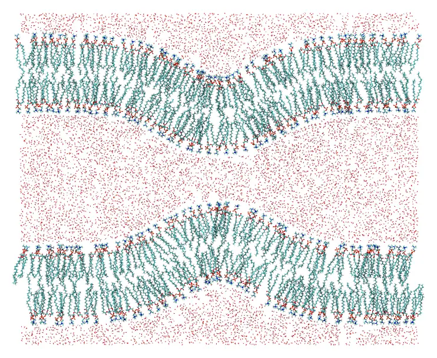

# Membrane tube with a neck

A POPC membrane tube with a neck, a constriction such as those that precede the fission of
membrane tubes, with water inside and outside, in a periodic cell along the axis of the
tube. The shape is not one of the constraints of Packmol: it is given by a function, the
radius of the midplane of the bilayer along the tube, and every layer of the system is a
[custom constraint](../constraints/custom.md) on the distance to that surface. The system
has 1.6 million atoms.



*A slab of 6 Å through the axis of the tube: the water inside, the two leaflets, which
bend at the neck, and the water outside. The tube crosses the periodic boundaries at the
left and right.*

Files: [`popc.pdb`](https://raw.githubusercontent.com/m3g/MolSimTestFiles/packmol_tutorials-v1/packmol_tutorials/popc.pdb), [`water.pdb`](https://raw.githubusercontent.com/m3g/MolSimTestFiles/packmol_tutorials-v1/packmol_tutorials/water.pdb), and the Julia script
[`membrane_neck.jl`](files/membrane_neck/membrane_neck.jl). Custom constraints exist
only in Julia code, so this tutorial has no input file.

## The shape

The midplane of the bilayer is a surface of revolution around the `z` axis, `r = ρ(z)`,
with a radius `R` = 80 Å far from the neck, narrowing to `Rn` = 48 Å at the neck, over
a width `σ` = 35 Å:

```julia
ρ(z) = R - (R - Rn) * exp(-z^2 / (2σ^2))
```

The neck is at `z = 0`, the middle of the periodic cell, which is 300 Å long: at its
ends, `z = ±150` Å, the tube has the radius `R`, and it continues smoothly into its
periodic images.

The layers are defined by the distance of a point to the midplane, `h`, positive outside
the tube. For a cylinder, `h` is the radial distance to the midplane, `r - R`. Where the
radius changes, the radial distance is longer than the distance to the surface, and, to
first order, the slope of the surface corrects it:

```julia
h(x) = (hypot(x[1], x[2]) - ρ(x[3])) / sqrt(1 + dρ(x[3])^2)
```

where `dρ` is the derivative of `ρ`. This is the distance to first order, exact for a
cylinder and accurate enough for the layers of a packing where the slope is moderate (up
to 0.6 here).

## The layers

The layers are those of the [Nanoliposomes](nanoliposome.md), at distances from the
midplane instead of radii: the heads of each leaflet (atom 1, the nitrogen of POPC)
beyond 28 Å of the midplane, the ends of the chains (atoms 88 and 131) within 6 Å of it,
and the water beyond 31 Å inside the tube and 30 Å outside. Each region is a
[`CustomConstraint`](@ref), a function that is positive outside the region and is a
distance, in Å (see [Custom constraints](../constraints/custom.md)):

```julia
beyond(d) = CustomConstraint(x -> d - h(x)) # h ≥ d
within(d) = CustomConstraint(x -> h(x) - d) # h ≤ d
```

| Layer | Region |
|:--|:--|
| water inside | `h ≤ -31` |
| inner leaflet: heads | `h ≤ -28` |
| inner leaflet: chain ends | `h ≥ -6` |
| outer leaflet: chain ends | `h ≤ 6` |
| outer leaflet: heads | `h ≥ 28` |
| water outside | `h ≥ 30` |

No `gradient` is given to the constraints, so their gradients are computed by central
finite differences, the default of `CustomConstraint` (six evaluations of the function for
each atom outside its region), which is accurate and cheap enough here. Exact gradients can
be given with the `gradient` keyword, for example computed by automatic differentiation
with ForwardDiff.jl (see [Custom constraints](../constraints/custom.md)).

## The numbers of molecules

As in the nanoliposomes, the number of lipids of each leaflet is limited by its narrow
surface: the heads of the inner leaflet, and the midplane for the outer leaflet. The areas
of these surfaces, and the volumes of the water inside and outside the tube, are integrals
along the tube, computed numerically. With 64 Ų per lipid at the narrow surfaces, plus
10%, and water at 1 g/mL:

| | Number |
|:--|--:|
| inner leaflet | 1,428 |
| outer leaflet | 2,373 |
| water inside | 53,475 |
| water outside | 303,778 |

The cell is orthorhombic, 250 × 250 × 300 Å, with 15 Å of water between the outer heads
and its faces, far from the neck.

## Julia script

```julia
using Packmol

# Geometry (Å)
const R = 80.0     # radius of the midplane of the tube, far from the neck
const Rn = 48.0    # radius of the midplane at the neck
const σ = 35.0     # width of the neck
const L = 300.0    # length of the periodic cell, along the tube
const a = 2 * (R + 30 + 15) # side of the cell, perpendicular to the tube

# The midplane, r = ρ(z), and its slope
ρ(z) = R - (R - Rn) * exp(-z^2 / (2σ^2))
dρ(z) = (R - Rn) * z / σ^2 * exp(-z^2 / (2σ^2))

# Distance of a point to the midplane, positive outside the tube
h(x) = (hypot(x[1], x[2]) - ρ(x[3])) / sqrt(1 + dρ(x[3])^2)

# Regions beyond (h ≥ d) and within (h ≤ d) a distance d of the midplane. Without a
# `gradient` keyword, the gradients of the functions are computed by finite differences
beyond(d) = CustomConstraint(x -> d - h(x))
within(d) = CustomConstraint(x -> h(x) - d)

# Areas of the surfaces at a distance d of the midplane, and volumes inside them
const zs = range(-L/2, L/2; length = 3001)
area(d) = sum(2π * (ρ(z) + d) * sqrt(1 + dρ(z)^2) for z in zs) * step(zs)
volume(d) = sum(π * (ρ(z) + d)^2 for z in zs) * step(zs)

# 64 Ų per lipid at the narrow surface of each leaflet, plus 10%; water at 1 g/mL
n_inner = round(Int, 1.1 * area(-28) / 64)
n_outer = round(Int, 1.1 * area(0) / 64)
n_water_inside = round(Int, volume(-31) / 29.9)
n_water_outside = round(Int, (a^2 * L - volume(30)) / 29.9)

molecules = [
    structure_type("water.pdb"; number = n_water_inside, constraints = [within(-31.0)]),
    structure_type("popc.pdb"; number = n_inner,
        atom_constraints = [[1] => within(-28.0), [88, 131] => beyond(-6.0)]),
    structure_type("popc.pdb"; number = n_outer,
        atom_constraints = [[88, 131] => within(6.0), [1] => beyond(28.0)]),
    structure_type("water.pdb"; number = n_water_outside, constraints = [beyond(30.0)]),
]
system = PackmolSystem(molecules;
    output = "membrane_neck.pdb", tolerance = 2.0,
    unitcell = [a, a, L, 90, 90, 90], # orthorhombic, centered at the origin
    # uncomment to only place the molecules
    # check_initial_placement = true,
)
packmol(system)
```

The system packs in about 2.5 minutes with 14 threads (`julia -t 14 membrane_neck.jl`).
Another neck is a change of `Rn` and `σ`; another shape, a change of `ρ`: a tube that
narrows to a pore, a pearled tube with several necks, or a tube that is not straight, with
`h` the distance to its axis curve.
