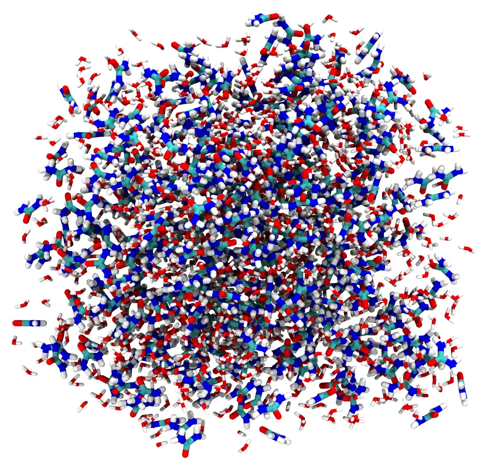

# Water and urea

A box of 1000 water molecules and 400 urea molecules: the simplest kind of system, in
which every molecule is placed in the same region.



Files: [`water.pdb`](files/mixture/water.pdb), [`urea.pdb`](files/mixture/urea.pdb) and
the input file [`mixture.inp`](files/mixture/mixture.inp).

## Command line

The input file:

```@eval
Main.input_file("files/mixture/mixture.inp")
```

Run it with:

```
packmol mixture.inp
```

(or `packmol < mixture.inp`). The packed system is written to `mixture.pdb`. A system
this simple needs no check of the initial placement, but the input has the
`check_initial_placement` line, commented, as all the tutorials (see
[Checking the initial placement](@ref check_initial_placement)).

## Julia

Each `structure ... end structure` block is a [`structure_type`](@ref), and the global
keywords (`tolerance`, `output`) are keyword arguments of [`PackmolSystem`](@ref):

```julia
using Packmol

water = structure_type("water.pdb";
    number = 1000,
    constraints = [InsideBox([0., 0., 0.], [40., 40., 40.])],
)
urea = structure_type("urea.pdb";
    number = 400,
    constraints = [InsideBox([0., 0., 0.], [40., 40., 40.])],
)

system = PackmolSystem([water, urea];
    output = "mixture.pdb",
    tolerance = 2.0,
    # check_initial_placement = true, # uncomment to only place the molecules
)
packmol(system)
```

`InsideBox(lower, upper)` takes the same parameters as `inside box`: the minimum and
maximum coordinates. The output format follows the extension of the output file, so
`filetype` is not needed.

The packed coordinates are also available without reading the output file:
`get_atoms(system)` returns them as a vector of atoms.
