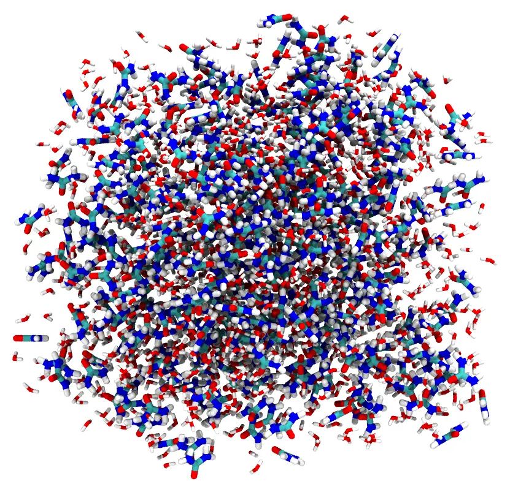

# Water and urea

A box of 1000 water molecules and 400 urea molecules: the simplest kind of system, in
which every molecule is placed in the same region.



Files: [`water.pdb`](https://m3g.github.io/packmol/examples/water.pdb),
[`urea.pdb`](https://m3g.github.io/packmol/examples/urea.pdb) and the input file
[`mixture.inp`](https://m3g.github.io/packmol/examples/mixture-comment.inp).

## Command line

The input file:

```
#
# A mixture of water and urea
#

# All the atoms from different molecules will be separated at least 2.0
# Angstroms in the solution.

tolerance 2.0

# The file type of the input and output files is PDB

filetype pdb

# The name of the output file

output mixture.pdb

# 1000 water molecules and 400 urea molecules will be put in a box
# defined by the minimum coordinates x, y and z = 0. 0. 0. and maximum
# coordinates 40. 40. 40. That is, they will be put in a cube of side
# 40. (the keyword "inside cube 0. 0. 0. 40." could be used as well).

structure water.pdb
  number 1000
  inside box 0. 0. 0. 40. 40. 40.
end structure

structure urea.pdb
  number 400
  inside box 0. 0. 0. 40. 40. 40.
end structure
```

Run it with:

```
packmol mixture.inp
```

(or `packmol < mixture.inp`). The packed system is written to `mixture.pdb`.

## Julia

Each `structure ... end structure` block is a [`structure_type`](@ref), and the global
keywords (`tolerance`, `output`) are keyword arguments of [`PackmolSystem`](@ref):

```julia
using Packmol

water = structure_type("water.pdb";
    number = 1000,
    constraints = [InsideBox([0., 0., 0.], [40., 40., 40.])],
)
urea = structure_type("urea.pdb";
    number = 400,
    constraints = [InsideBox([0., 0., 0.], [40., 40., 40.])],
)

system = PackmolSystem([water, urea]; output = "mixture.pdb", tolerance = 2.0)
packmol(system)
```

`InsideBox(lower, upper)` takes the same parameters as `inside box`: the minimum and
maximum coordinates. The output format follows the extension of the output file, so
`filetype` is not needed.

The packed coordinates are also available without reading the output file:
`get_atoms(system)` returns them as a vector of atoms.
