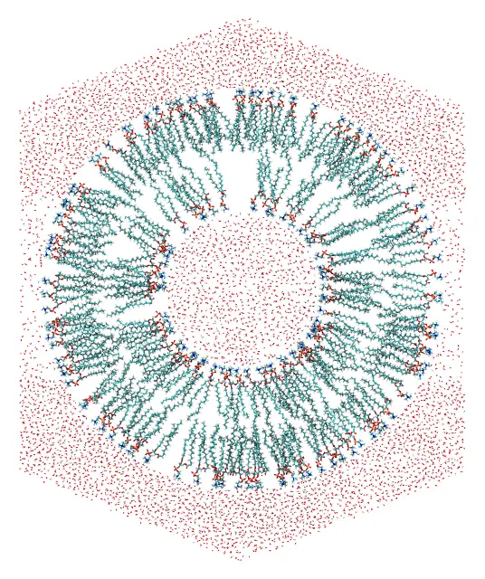
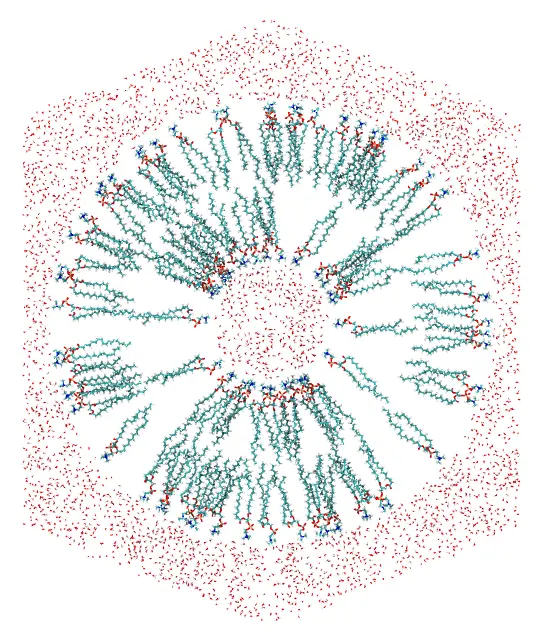
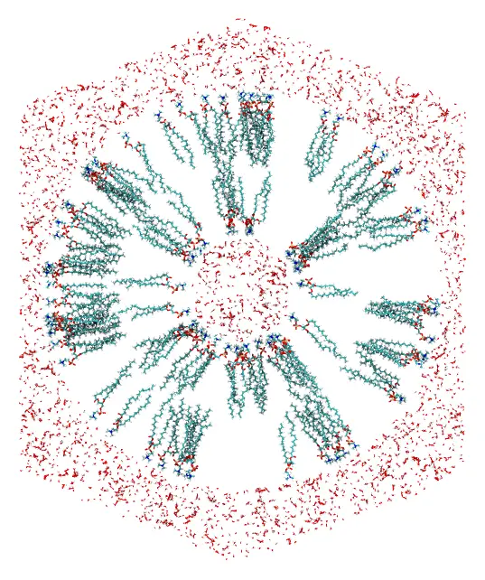

# Nanoliposomes

Two POPC nanoliposomes, a small one and a larger one, with water inside and around
them, in a periodic cell with the shape of a truncated octahedron. The water inside
and the two leaflets of the bilayer are placed in spherical shells, the water outside
fills the rest of the cell, and constraints on the polar heads and on the ends of the chains orient the lipids of
each leaflet. How many lipids fit in each leaflet depends on its curvature, which is
the main subject of this tutorial.



*A slab through the center of the larger nanoliposome: the water inside, the two
leaflets, and the water outside, which fills the truncated octahedron.*

Files: [`popc.pdb`](files/nanoliposome/popc.pdb),
[`water.pdb`](files/nanoliposome/water.pdb), and the input files
[`small.inp`](files/nanoliposome/small.inp) and
[`large.inp`](files/nanoliposome/large.inp).

The lipid is the POPC of the [Lipid bilayer](bilayer.md) tutorial (from the
`packmol_lipids` set of [MolSimTestFiles](https://github.com/m3g/MolSimTestFiles)): atom
1 is the nitrogen of the polar head, and atoms 88 and 131 are the ends of the two
chains, 26 Å from the head.

## The geometry

The leaflets are placed as in the flat bilayer: the head atoms in a narrow band, and
the chain ends within 6 Å of the middle of the bilayer. The heads and the chain ends of
each leaflet are then 22 Å apart, 85% of the length of the lipid. Everything follows
from the radius of the inner heads, R:

| Shell | Radii | Small (R = 25 Å) | Larger (R = 40 Å) |
|:------|:------|:-----------------|:------------------|
| water inside | r < R − 3 | r < 22 Å | r < 37 Å |
| inner leaflet: heads | r < R | r < 25 Å | r < 40 Å |
| inner leaflet: chain ends | r > R + 22 | r > 47 Å | r > 62 Å |
| middle of the bilayer | R + 28 | 53 Å | 68 Å |
| outer leaflet: chain ends | r < R + 34 | r < 59 Å | r < 74 Å |
| outer leaflet: heads | r > R + 56 | r > 81 Å | r > 96 Å |
| water outside | r > R + 58 | r > 83 Å | r > 98 Å |
| periodic cell (`d`) | 2(R + 58) + 20 | 186 Å | 216 Å |

The periodic cell is a truncated octahedron, the shape closest to a sphere among the
cells that fill space by translation, and thus the one that needs the least water
around a spherical object. With `pbc octahedral 0. 0. 0. d`, the faces closest to its
center (the hexagonal ones) are at d/2 from it, so the cells above have at least
10 Å of water between the nanoliposome and their faces: 20 Å of water between the
nanoliposome and its nearest periodic images.

Real liposomes are large: the smallest have diameters of about 20 nm. The small
nanoliposome has a diameter of 16 nm (at its outer heads), and the larger one of
19 nm. Even so, with the water, they have about 350 and 600 thousand atoms.

## Curvature and density

In a flat bilayer, the area available to each lipid is the same at the heads and at
the chain ends: 64 Ų for POPC. In a curved leaflet it is not. The surface of a
sphere grows with the square of its radius, so the area per lipid is smaller at the
heads of the inner leaflet than at its chain ends, and smaller at the chain ends of
the outer leaflet than at its heads. The lipids are rigid in the packing: they cannot
splay their chains to fill the wider end, nor squeeze them at the narrower one.

The number of lipids of each leaflet is then limited by its most crowded surface. A
safe count gives each lipid the 64 Ų of the flat bilayer there:

- inner leaflet: the surface of the heads, 4πR² / 64;
- outer leaflet: the surface of the middle of the bilayer, 4π(R + 28)² / 64.

The other end of each lipid has more room, and is less dense than in a flat bilayer:

| | Small (R = 25 Å) | Larger (R = 40 Å) |
|:--|:--|:--|
| inner leaflet, safe count | 4π × 25² / 64 = 123 | 4π × 40² / 64 = 314 |
| ⋯ area per lipid at its chain ends | 226 Ų | 154 Ų |
| outer leaflet, safe count | 4π × 53² / 64 = 552 | 4π × 68² / 64 = 908 |
| ⋯ area per lipid at its heads | 149 Ų | 128 Ų |

The excess area at the wider ends shrinks as the radius grows: from 3.5 times the
area of the flat bilayer (226 Ų) at the chain ends of the small inner leaflet, to 2.4
times (154 Ų) in the larger one. It only disappears in a flat bilayer, with R much
larger than the length of the lipid. Computing the number of lipids from the wider
surface instead (for the outer leaflet of the small nanoliposome,
4π × 81² / 64 = 1288) puts more than twice as many lipids in the leaflet as fit at
its narrow end, and the packing fails.

The safe count is a lower bound: the lipids are not cylinders, and some more fit. The
larger nanoliposome here has 20% more lipids than the safe count, 377 in the inner
leaflet and 1090 in the outer one, which still pack, with 53 Ų per lipid at the
narrow surfaces. The small nanoliposome also packs with 20% more lipids (148 and 662),
but it takes about twice as long as with the safe counts, which it has here:



*The small nanoliposome, with the safe counts: the lipids fan out from the inner heads,
and the outer heads are sparse.*

Compare the two images: in the small nanoliposome the empty space between the chain
ends of the inner leaflet, and between the heads of the outer leaflet, is evident. A
simulation closes it, with the lipids tilting and their chains filling the space, but
the bilayer may then be thinner, or the area per lipid larger, than in a flat
membrane. The larger the nanoliposome, the closer its initial configuration is to a
real bilayer, at the cost of a larger system.

The water inside is a sphere of radius R − 3, at 1 g/mL (29.9 ų per molecule): for
the small nanoliposome, 4/3 π 22³ / 29.9 = 1492 molecules. The water outside fills the
volume of the cell, 4√3/9 d³, minus that of the sphere of radius R + 58:
(4√3/9 × 186³ − 4/3 π 83³) / 29.9 = 85567 molecules.

## Command line

```@raw html
<details><summary>The input file <code>small.inp</code> (click to expand)</summary>
```
```@eval
Main.input_file("files/nanoliposome/small.inp")
```
```@raw html
</details><br>
```

The lipids have no constraint on the whole molecule: only the head and the chain ends
are constrained, and the rest of each molecule follows them. The outer water is only
constrained to be outside the sphere: the periodic cell bounds it. The molecules are
packed in the parallelepiped of the cell, as any triclinic cell, and
`periodic_boundary_style octahedral` writes them wrapped into the truncated octahedron,
around the nanoliposome (see [Truncated octahedral
box](../periodic_boundary_conditions/truncated_octahedral_box.md)).

The input file of the larger nanoliposome, [`large.inp`](files/nanoliposome/large.inp),
is the same, with the radii and numbers of the tables above.

### Check the initial placement first

Uncomment the `check_initial_placement` line of the input file, and run it as below
(see [Checking the initial placement](@ref check_initial_placement)): the initial
placement of the molecules is written to the output file (`small.pdb`):



*A slab through the center of the initial approximation of the small nanoliposome: the
two leaflets and the water are already in their shells, but molecules may overlap.*

Then comment the line again, and run the packing.

### Packing

Run it with:

```
packmol small.inp
```

The packed system is written to `small.pdb`, in about 3 minutes with 14 threads.
The larger nanoliposome (`packmol large.inp`) takes about 10 minutes.

## Julia

In Julia, the geometry of the table above can be written once, as a function of the
radius of the inner heads, and of the numbers of lipids of the two leaflets:

```julia
using Packmol

function nanoliposome(R, n_inner, n_outer, output)
    origin = [0., 0., 0.]
    d = 2 * (R + 58) + 20 # size of the truncated octahedron
    # Water at 1 g/mL: 29.9 ų per molecule
    water_inside = structure_type("water.pdb";
        number = round(Int, 4/3 * π * (R - 3)^3 / 29.9),
        constraints = [InsideSphere(origin, R - 3)],
    )
    # Heads (atom 1) in, chain ends (atoms 88 and 131) out
    inner_leaflet = structure_type("popc.pdb";
        number = n_inner,
        atom_constraints = [
            [1] => InsideSphere(origin, R),
            [88, 131] => OutsideSphere(origin, R + 22),
        ],
    )
    # Chain ends in, heads out
    outer_leaflet = structure_type("popc.pdb";
        number = n_outer,
        atom_constraints = [
            [88, 131] => InsideSphere(origin, R + 34),
            [1] => OutsideSphere(origin, R + 56),
        ],
    )
    water_outside = structure_type("water.pdb";
        number = round(Int, (4 * sqrt(3) / 9 * d^3 - 4/3 * π * (R + 58)^3) / 29.9),
        constraints = [OutsideSphere(origin, R + 58)],
    )
    system = PackmolSystem([water_inside, inner_leaflet, outer_leaflet, water_outside];
        output, tolerance = 2.0,
        unitcell = octahedral_unitcell(Float64, d), # centered at the origin
        # check_initial_placement = true, # uncomment to only place the molecules
    )
    # Write the output in the shape of the truncated octahedron
    triclinic_to_octahedral(system)
    return system
end

# The safe counts: 64 Ų per lipid at the narrow surface of each leaflet
safe_count(r) = round(Int, 4π * r^2 / 64)

small = nanoliposome(25.0, safe_count(25), safe_count(25 + 28), "small.pdb")
packmol(small)

# 20% more lipids than the safe counts
large = nanoliposome(40.0, 377, 1090, "large.pdb")
packmol(large)
```

As with the input file, check the initial placement first, with
`check_initial_placement = true` (commented in the code above).

`InsideSphere(center, radius)` and `OutsideSphere(center, radius)` take the parameters
of `inside sphere` and `outside sphere`.
