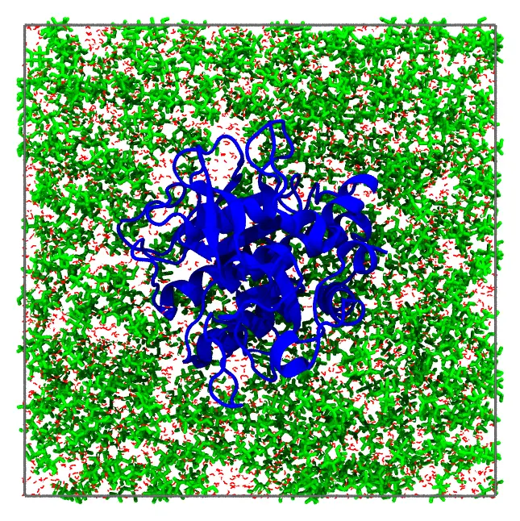

# Protein in glycerol and water

A protein solvated by a mixture of glycerol and water, 50% in mass, in a periodic box: a
system of the [ComplexMixtures.jl](https://github.com/m3g/ComplexMixtures.jl)
[examples](https://github.com/m3g/ComplexMixturesExamples), where the solvation of the
protein by each component of the mixture is studied. The protein is fixed at the center
of the box, and the mixture fills the rest of it.



*The protein, glycerol (green) and water (red), in the half of the box behind the protein,
with the edges of the periodic box.*

Files: [`protein.pdb`](files/protein_glycerol/protein.pdb),
[`glycerol.pdb`](files/protein_glycerol/glycerol.pdb),
[`water.pdb`](files/protein_glycerol/water.pdb), and the input file
[`protein_glycerol.inp`](files/protein_glycerol/protein_glycerol.inp).

## The numbers of molecules

The box is a cube with sides of 76 Å, which leaves at least 12 Å of solvent around the
protein (its largest dimension is 51 Å). The mixture of glycerol (92.09 g/mol) and water
(18.02 g/mol), 50% in mass, has a density of 1.126 g/mL. In 1 g of it there are
0.5/92.09 mol of glycerol and 0.5/18.02 mol of water, so its number densities are:

- glycerol: 1.126 × (0.5/92.09) × 0.6022 = 0.00368 molecules per ų;
- water: 1.126 × (0.5/18.02) × 0.6022 = 0.01882 molecules per ų.

The protein (27.3 kDa) occupies about 27300/(1.35 × 0.6022) = 33600 ų (the density of
proteins is about 1.35 g/mL), so the solution has 76³ − 33600 = 405400 ų: 1493 molecules of
glycerol and 7630 of water.

!!! tip
    The `SolutionBoxUSC` recipe (see [Recipes](../recipes/solute_solvent_cossolvent_system.md))
    computes these numbers from the density of the mixture as a function of its
    concentration, given as a table, in any concentration unit.

## Command line

The input file:

```
#
# A protein in a mixture of glycerol and water, 50% in mass (1.126 g/mL),
# in a periodic cubic box with sides of 76 Å.
#
tolerance 2.0
output protein_glycerol.pdb
pbc -38. -38. -38. 38. 38. 38.

# The protein, fixed with its center at the center of the box
structure protein.pdb
  number 1
  center
  fixed 0. 0. 0. 0. 0. 0.
end structure

structure glycerol.pdb
  number 1493
end structure

structure water.pdb
  number 7630
end structure
```

The periodic box confines the molecules of the solvent, so they need no constraint. The
protein is fixed with its geometric center (`center`) at the center of the box: all its
atoms must be inside the periodic box (see [Fixed molecules](../constraints/fixed.md)).

### Check the initial approximation first

Add the `check` keyword to the input file, and run it as below. Packmol builds only the
initial approximation, in a fraction of a second, and writes it to the output file
(`protein_glycerol.pdb`): look at it to see that the protein is at the center of the box,
and the solvent around it. Then remove `check`, and run the packing.

### Packing

```
packmol protein_glycerol.inp
```

The packing (about 48 thousand atoms) takes about 2 seconds.

## Julia

```julia
using Packmol

protein = structure_type("protein.pdb";
    number = 1,
    fixed = ([0., 0., 0.], [0., 0., 0.]),
    center = :geometric,
)
glycerol = structure_type("glycerol.pdb"; number = 1493)
water = structure_type("water.pdb"; number = 7630)
system = PackmolSystem([protein, glycerol, water];
    output = "protein_glycerol.pdb",
    tolerance = 2.0,
    unitcell = [76. 0. 0.; 0. 76. 0.; 0. 0. 76.], # centered at the origin
)
packmol(system)
```

As with the input file, check the initial approximation first, with
`PackmolSystem(...; check = true)`.
