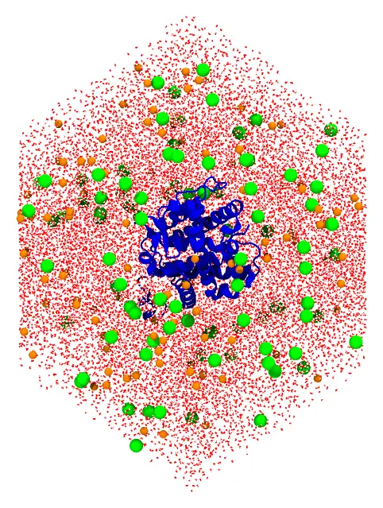
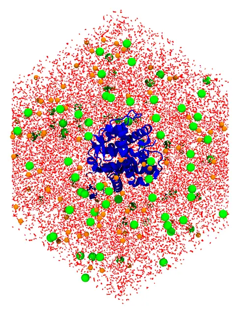

# Solvated protein

A protein of 4246 atoms in water and sodium and chloride ions, in a periodic cell with the
shape of a rhombic dodecahedron. The protein is fixed at the center of the cell, and the
solvent fills the space around it. The protein is that of
[Martínez L., et al. J. Med. Chem. 49, 23–26, 2006](https://doi.org/10.1021/jm050805n),
where it was solvated in a sphere of water (the classic example of Packmol).



*The protein, the ions, and the water behind the protein, in the rhombic dodecahedron.*

Files: [`protein.pdb`](files/solvprotein/protein.pdb),
[`water.pdb`](files/solvprotein/water.pdb), [`CLA.pdb`](files/solvprotein/CLA.pdb),
[`SOD.pdb`](files/solvprotein/SOD.pdb) and the input file
[`solvprotein.inp`](files/solvprotein/solvprotein.inp).

## The periodic cell and the numbers of molecules

A rhombic dodecahedron is the usual cell for a single solute that is roughly spherical: for
the same distance between periodic images, it has 70.7% of the volume of a cube (see
[Rhombic dodecahedral box](../periodic_boundary_conditions/rhombic_dodecahedral_box.md)),
and thus 30% fewer water molecules to simulate.

- **The cell.** The atoms of the protein are at most 45.9 Å from its center. With at least
  12 Å of water between the protein and the faces of the cell, the distance between
  opposite faces is `d = 2 × (45.9 + 12) ≈ 116` Å, and the volume of the cell is
  `d³/√2 = 1,103,700` ų.
- **Water.** The protein (267 residues, about 29.4 kDa) occupies about 35,600 ų
  (0.73 mL/g). The remaining 1,068,100 ų hold 35,670 water molecules at 1 g/mL
  (0.0334 molecules per ų); 35,480 leave room for the ions.
- **Ions.** 0.15 mol/L of NaCl in that volume are 96 ion pairs. The protein has a charge of
  −10 (30 arginines and lysines, 40 aspartates and glutamates), neutralized by 10 more
  sodium ions: 96 chloride and 106 sodium ions.

## Command line

```@raw html
<details><summary>The input file <code>solvprotein.inp</code> (click to expand)</summary>
```
```@eval
Main.input_file("files/solvprotein/solvprotein.inp")
```
```@raw html
</details><br>
```

`pbc dodecahedral cx cy cz d` sets the cell, centered at `(cx, cy, cz)`, and
`periodic_boundary_style dodecahedral` writes the output in its shape (without it, the
molecules are written in the parallelepiped of the cell vectors, which is the same
periodic system). The cell confines the water and the ions: no constraint is needed. No
constraint keeps the solvent away from the protein either: the protein is fixed, and the
packing itself keeps the other molecules at least `tolerance` away from its atoms.

### Check the initial placement first

Uncomment the `check_initial_placement` line of the input file, and run it as below
(see [Checking the initial placement](@ref check_initial_placement)): the initial
placement of the molecules is written to the output file (`solvprotein.pdb`):



*The initial placement: the solvent fills the cell around the fixed protein, but molecules may overlap, also with the protein.*

Then comment the line again, and run the packing.

### Packing

Run it with:

```
packmol solvprotein.inp
```

The packed system (about 111 thousand atoms) is written to `solvprotein.pdb`; the packing
takes about a second.

## Julia

```julia
using Packmol

protein = structure_type("protein.pdb";
    number = 1,
    fixed = ([0., 0., 0.], [0., 0., 0.]),
    center = :mass,
)
water = structure_type("water.pdb"; number = 35480)
chloride = structure_type("CLA.pdb"; number = 96)
sodium = structure_type("SOD.pdb"; number = 106)

system = PackmolSystem([protein, water, chloride, sodium];
    output = "solvprotein.pdb",
    tolerance = 2.0,
    unitcell = dodecahedral_unitcell(Float64, 116.0), # centered at the origin
    # check_initial_placement = true, # uncomment to only place the molecules
)
# Write the output in the shape of the rhombic dodecahedron
triclinic_to_dodecahedral(system)
packmol(system)
```

As with the input file, check the initial placement first, with
`check_initial_placement = true` (commented in the code above).

[`dodecahedral_unitcell`](@ref)`(T, d)` is the matrix of the cell vectors of `pbc
dodecahedral` (the cell is centered at the origin, unless `unitcell_center` is given).

!!! tip
    The `SolutionBoxUWI` recipe solvates a protein with water and ions from a
    target ionic concentration (neutralizing its charge), in a periodic cell of any of
    these shapes (`pbc = :dodecahedral`). See [Recipes](../recipes/index.md).
