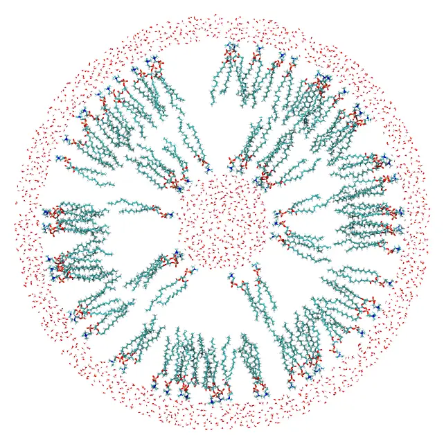
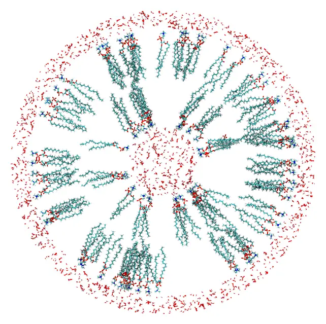

# Spherical vesicle

A POPC vesicle with water inside and around it. The water and the two leaflets of the
vesicle are placed in spherical shells, and constraints on the polar heads and on the
ends of the chains orient the lipids of each leaflet.



*A slab through the center of the vesicle: the water inside, the two leaflets, and the
water outside.*

Files: [`popc.pdb`](files/vesicle/popc.pdb), [`water.pdb`](files/vesicle/water.pdb) and
the input file [`vesicle.inp`](files/vesicle/vesicle.inp).

The lipid is the POPC of the [Lipid bilayer](bilayer.md) tutorial (from the
`packmol_lipids` set of [MolSimTestFiles](https://github.com/m3g/MolSimTestFiles)): atom
1 is the nitrogen of the polar head, and atoms 88 and 131 are the ends of the two
chains, 26 Å from the head.

## The size of the vesicle

Real vesicles are large: the smallest have diameters of about 20 nm. A POPC bilayer is
about 55 Å thick (with its head groups), so a vesicle with some water inside is already
a system of about 200 thousand atoms. Here, the vesicle has 25 Å of water inside, and
an outer radius of about 81 Å: a diameter of 16 nm, a little smaller than the smallest
real vesicles.

The leaflets are placed as in the flat bilayer: the head atoms in a narrow band, and
the chain ends within 6 Å of the middle of the bilayer, at r = 53 Å:

| Leaflet | Heads (atom 1) | Chain ends (atoms 88, 131) |
|:--------|:---------------|:---------------------------|
| inner   | r < 25 Å       | r > 47 Å                   |
| outer   | r > 81 Å       | r < 59 Å                   |

The heads and the chain ends of each leaflet are 22 Å apart, 85% of the length of the
lipid, as in the bilayer.

## The numbers of lipids

In a curved leaflet, the area available to each lipid is not the same at the heads and
at the chain ends: it is smaller at the heads of the inner leaflet, and at the chain
ends of the outer leaflet. The lipids are rigid in the packing, so the number of lipids
of each leaflet is limited by its most crowded surface, with the 64 Ų per lipid of
the flat bilayer:

- inner leaflet: the surface of the heads, 4π × 25² / 64 = 123 lipids;
- outer leaflet: the surface of the middle of the bilayer, 4π × 53² / 64 = 552 lipids.

The other ends of the lipids are then less dense than in a flat bilayer, which a
simulation relaxes. Computing the numbers of lipids from the area at the heads of the
outer leaflet (4π × 81² / 64 = 1288) would put twice as many lipids in it as fit at
its chain ends, and the packing would fail.

The water inside is a sphere of radius 22 Å, with 4/3 π 22³ / 29.9 = 1492 molecules
(29.9 ų per molecule at 1 g/mL), and the water outside a shell from 83 Å to 95 Å,
with 40009 molecules.

## Command line

The input file:

```
#
# POPC vesicle with water inside and outside
#
tolerance 2.0
output vesicle.pdb

# Water inside the vesicle: a sphere of radius 22 Å
structure water.pdb
  number 1492
  inside sphere 0. 0. 0. 22.
end structure

# Inner leaflet: the heads (atom 1, N) inside the sphere of radius 25 Å, pointing to
# the water inside, and the ends of the chains (atoms 88 and 131) outside the sphere
# of radius 47 Å, near the middle of the bilayer (r = 53 Å)
structure popc.pdb
  number 123
  atoms 1
    inside sphere 0. 0. 0. 25.
  end atoms
  atoms 88 131
    outside sphere 0. 0. 0. 47.
  end atoms
end structure

# Outer leaflet: the ends of the chains inside the sphere of radius 59 Å, and the
# heads outside the sphere of radius 81 Å, pointing to the water outside
structure popc.pdb
  number 552
  atoms 88 131
    inside sphere 0. 0. 0. 59.
  end atoms
  atoms 1
    outside sphere 0. 0. 0. 81.
  end atoms
end structure

# Water outside the vesicle: a shell from 83 to 95 Å
structure water.pdb
  number 40009
  outside sphere 0. 0. 0. 83.
  inside sphere 0. 0. 0. 95.
end structure
```

The lipids have no constraint on the whole molecule: only the head and the chain ends
are constrained, and the rest of each molecule follows them. The outer water has two
constraints on every atom, which together define a spherical shell. A thicker layer of
water, or a periodic box around the vesicle, can be built the same way, with many more
water molecules.

### Check the initial approximation first

For a system with spherical shells and lipids oriented by constraints on some of their
atoms, first check that the constraints place the molecules where intended. Add the
`check` keyword to the input file:

```
check
```

and run it as below. Packmol then only builds the initial approximation, in a few
seconds: each molecule is placed in its region, satisfying the constraints, but the
molecules may still overlap. It is written to the output file (`vesicle.pdb`). Look at
it in a molecular visualization program:



*A slab through the center of the initial approximation: the two leaflets and the water
are already in their shells, but molecules may overlap.*

When the molecules are where they should be, remove `check`, and run the packing.
If the constraints cannot be satisfied at all, even without the distances between the
molecules, Packmol stops after the initial approximation with an error (unless the
`continue_failed_initial_packing` keyword is set): that is almost always a sign of
wrong constraints.

### Packing

Run it with:

```
packmol vesicle.inp
```

The packed system (about 215 thousand atoms) is written to `vesicle.pdb`, in about 10
minutes with 8 threads.

## Julia

```julia
using Packmol

origin = [0., 0., 0.]
water_inside = structure_type("water.pdb";
    number = 1492,
    constraints = [InsideSphere(origin, 22.0)],
)
# Heads (atom 1) in, chain ends (atoms 88 and 131) out
inner_leaflet = structure_type("popc.pdb";
    number = 123,
    atom_constraints = [
        [1] => InsideSphere(origin, 25.0),
        [88, 131] => OutsideSphere(origin, 47.0),
    ],
)
# Chain ends in, heads out
outer_leaflet = structure_type("popc.pdb";
    number = 552,
    atom_constraints = [
        [88, 131] => InsideSphere(origin, 59.0),
        [1] => OutsideSphere(origin, 81.0),
    ],
)
water_outside = structure_type("water.pdb";
    number = 40009,
    constraints = [OutsideSphere(origin, 83.0), InsideSphere(origin, 95.0)],
)

system = PackmolSystem([water_inside, inner_leaflet, outer_leaflet, water_outside];
    output = "vesicle.pdb",
    tolerance = 2.0,
)
packmol(system)
```

As with the input file, check the initial approximation first, with
`PackmolSystem(...; check = true)`.

`InsideSphere(center, radius)` and `OutsideSphere(center, radius)` take the parameters
of `inside sphere` and `outside sphere`.
