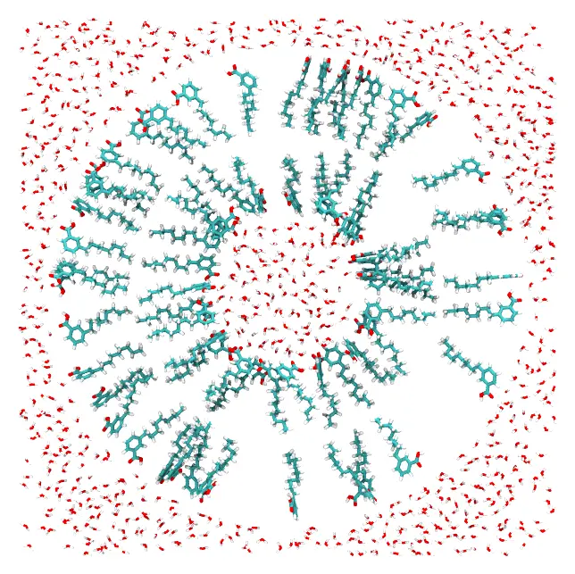
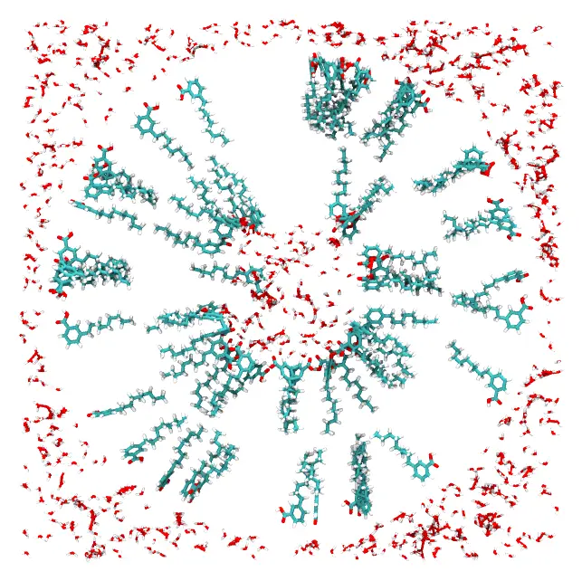

# Spherical vesicle

A vesicle with a double layer of lipids, water inside it and water around it. Every
component is placed in a spherical shell, and constraints on the atoms of the polar
heads and of the tails orient the lipids of each layer.



*A slab through the center of the vesicle: the water inside, the two layers of lipids, and the water outside.*

Files: [`palmitoil.pdb`](https://m3g.github.io/packmol/examples/palmitoil.pdb),
[`water.pdb`](https://m3g.github.io/packmol/examples/water.pdb) and the input file
[`spherical.inp`](https://m3g.github.io/packmol/examples/spherical-comment.inp).

In `palmitoil.pdb`, atom 37 belongs to the polar head of the lipid, and atom 5 to its
hydrophobic tail. The system has about 70 thousand atoms.

## Command line

The input file:

```
#
# Double layered vesicle with water inside and outside
#

# All the atoms from different molecules will be at least 2.0 Angstroms
# apart in the solution

tolerance 2.0

# The output file name

output spherical.pdb

# File types are in pdb format

filetype pdb

# A small sphere of water molecules that will be inside the vesicle:
# 308 water molecules will be put in a sphere of radius 13 centered
# at the origin.

structure water.pdb
   number 308
   inside sphere 0. 0. 0. 13.
end structure

# 90 lipids will be put around the small water sphere. The polar heads
# of these lipids will point to the water (that's why atom 37 of the
# molecule is constrained to be inside the sphere of radius 14), while
# the hydrophobic ends of the lipids will point outwards (that's why
# atom 5 of the lipid is constrained to be outside the sphere of
# radius 26).

structure palmitoil.pdb
  number 90
  atoms 37
    inside sphere 0. 0. 0. 14.
  end atoms
  atoms 5
    outside sphere 0. 0. 0. 26.
  end atoms
end structure

# Now, 300 lipids will form a new, larger layer. The hydrophobic ends of
# these lipids will point inwards, in such a way that they interact
# with the hydrophobic part of the lipids of the smaller layer. The
# polar heads will point outwards.

structure palmitoil.pdb
  number 300
  atoms 5
    inside sphere 0. 0. 0. 29.
  end atoms
  atoms 37
    outside sphere 0. 0. 0. 41.
  end atoms
end structure

# Finally, 17536 water molecules will form the outer solvation shell.
# These molecules are put outside the sphere that contains the whole
# system defined before (a sphere of radius 43) and inside a box of
# side 95 Angstroms, defined by the minimum coordinates x, y, z = -47.5
# and maximum coordinates x, y, z = 47.5

structure water.pdb
   number 17536
   inside box -47.5 -47.5 -47.5 47.5 47.5 47.5
   outside sphere 0. 0. 0. 43.
end structure
```

The lipids have no constraint on the whole molecule: only atoms 37 and 5 are
constrained, and the rest of each molecule follows them. The outer water has two
constraints on every atom, which together carve a spherical hole in the box.

### Check the initial approximation first

For a system with spherical shells and lipids oriented by constraints on some of their atoms, first check that the constraints place the molecules where
intended. Add the `check` keyword to the input file:

```
check
```

and run it as below. Packmol then only builds the initial approximation, in a fraction
of a second: each molecule is placed in its region, satisfying the constraints, but the
molecules may still overlap. It is written to the output file (`spherical.pdb`). Look at it in
a molecular visualization program:



*A slab through the center of the initial approximation: the two lipid layers and the water are already in their shells, but molecules may overlap.*

When the molecules are where they should be, remove `check`, and run the packing.
If the constraints cannot be satisfied at all, even without the distances between the
molecules, Packmol stops after the initial approximation with an error (unless the
`continue_failed_initial_packing` keyword is set): that is almost always a sign of
wrong constraints.

### Packing

Run it with:

```
packmol spherical.inp
```

The packed system is written to `spherical.pdb`.

## Julia

```julia
using Packmol

origin = [0., 0., 0.]
water_inside = structure_type("water.pdb";
    number = 308,
    constraints = [InsideSphere(origin, 13.0)],
)
# Polar heads (atom 37) in, tails (atom 5) out
inner_layer = structure_type("palmitoil.pdb";
    number = 90,
    atom_constraints = [
        [37] => InsideSphere(origin, 14.0),
        [5] => OutsideSphere(origin, 26.0),
    ],
)
# Tails in, polar heads out
outer_layer = structure_type("palmitoil.pdb";
    number = 300,
    atom_constraints = [
        [5] => InsideSphere(origin, 29.0),
        [37] => OutsideSphere(origin, 41.0),
    ],
)
water_outside = structure_type("water.pdb";
    number = 17536,
    constraints = [
        InsideBox([-47.5, -47.5, -47.5], [47.5, 47.5, 47.5]),
        OutsideSphere(origin, 43.0),
    ],
)

system = PackmolSystem([water_inside, inner_layer, outer_layer, water_outside];
    output = "spherical.pdb",
    tolerance = 2.0,
)
packmol(system)
```

As with the input file, check the initial approximation first, by building the system
with `check = true` (`PackmolSystem(...; check = true)`): `packmol(system)` then writes
the initial approximation to the output file, and stops.

`InsideSphere(center, radius)` and `OutsideSphere(center, radius)` take the parameters
of `inside sphere` and `outside sphere`.

!!! tip "Threads"
    Packmol runs in parallel. In Julia, it uses the threads of the session (start
    Julia with `julia -t auto`); the `packmol` executable uses all the available cores.
    `packmol(system; nthreads = 4)`, the input keyword `nthreads 4` or `packmol -t 4`
    limit the number of threads used.
