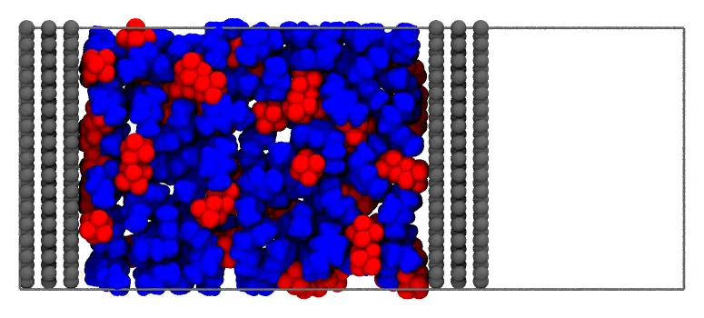
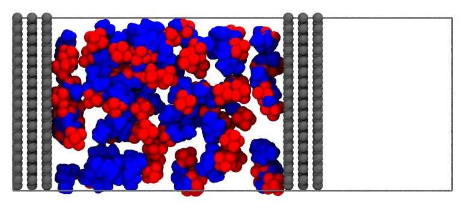

# Ionic liquid in a supercapacitor

The ionic liquid 1-butyl-3-methylimidazolium hexafluorophosphate, [BMIM][PF₆], between two
charged graphite electrodes: the cell of an electric double-layer capacitor
(supercapacitor), which stores charge in the layers of ions at the surfaces of its
electrodes. The electrodes are fixed, periodic in `x` and `y`, and the liquid is packed
between them, with the composition of the first layer of ions on each electrode set by
the charge of the electrode.



*A slice of 12 Å of the system, seen along `y`: the cathode (left) and the anode
(right), the cations (blue) and the anions (red), and the periodic cell, closed by a
vacuum gap beyond the anode.*

Files: [`electrodes.pdb`](files/supercapacitor/electrodes.pdb),
[`bmim.pdb`](files/supercapacitor/bmim.pdb), [`pf6.pdb`](files/supercapacitor/pf6.pdb),
and the input file [`supercapacitor.inp`](files/supercapacitor/supercapacitor.inp).

## The structures

- **The electrodes**: two blocks of graphite, of three graphene layers each (AB stacked,
  3.35 Å apart), 39.36 × 42.60 Å, a whole number of cells of graphene, so that the
  sheets are continuous across the periodic boundaries in `x` and `y`. The surfaces of
  the electrodes facing the liquid are at `z = 7.7` (the cathode) and `z = 62.7` Å (the
  anode). They were built by the script `electrodes.jl`:

```@raw html
<details><summary>The script <code>electrodes.jl</code> (click to expand)</summary>
```
```@eval
Main.input_file("files/supercapacitor/electrodes.jl")
```
```@raw html
</details><br>
```

- **The ions**: the cation was built by [Open Babel](https://openbabel.org) from its
  SMILES (`obabel -:"CCCCn1cc[n+](C)c1" -O bmim.pdb --gen3d -h`), and the anion, an
  octahedron with P–F bonds of 1.59 Å, by hand.

## The numbers of ions

The periodic cell, `pbc 39.36 42.6 100.0`, has the electrodes and the liquid between them,
and a vacuum gap of 30 Å beyond the anode, which separates the anode from the periodic
image of the cathode. The cell is periodic in `z` too, as Packmol's periodic cells are,
but the gap keeps the two electrodes apart, as in the simulations of electrode
interfaces (with a correction of the electrostatics of the slab).

The space between the electrodes available to the ions, given by [`free_volume`](@ref)
(see [Volume estimates](@ref)), is 85900 ų, which holds 250 ion pairs at the density of
[BMIM][PF₆], 1.37 g/mL (284.2 g/mol per ion pair).

The electrodes carry charges of -10 e (the cathode) and +10 e (the anode): 9.6 μC/cm² on
their 1677 Ų, the order of the charges of the electrodes of supercapacitors. Each charge
is screened by the first layer of ions on the electrode, the 8 Å nearest to it, which has
10 more counterions than coions:

| Region | `z` (Å) | Cations | Anions | Charge |
|:--|:--:|--:|--:|--:|
| layer on the cathode | 7.7 – 15.7 | 35 | 25 | +10 |
| bulk liquid | 15.7 – 54.7 | 190 | 190 | 0 |
| layer on the anode | 54.7 – 62.7 | 25 | 35 | -10 |

Every region has the density of the liquid, in the volume available to its ions
(`free_volume` again: 10300 ų in each layer, 65400 ų in the bulk). The whole system,
250 ion pairs, is neutral.

## Command line

```@raw html
<details><summary>The input file <code>supercapacitor.inp</code> (click to expand)</summary>
```
```@eval
Main.input_file("files/supercapacitor/supercapacitor.inp")
```
```@raw html
</details><br>
```

The electrodes are a single fixed molecule (see [Fixed molecules](../constraints/fixed.md)),
with the `radius` of their atoms set to 1.5 Å, so that the atoms of the ions are at least
2.5 Å from the carbon atoms. Each region of the table above is a box, and each kind of
ion in it a structure block: the cations and the anions of the same region have the same
constraint, and the composition of the region is given by their numbers. The whole ions
are kept in their regions: the boundaries between the regions are planes, which the
packing does not cross, and a simulation relaxes them.

### Check the initial placement first

Uncomment the `check_initial_placement` line of the input file, and run it as below
(see [Checking the initial placement](@ref check_initial_placement)): the initial
placement, written to the output file in a fraction of a second, has the ions in their
regions, between the electrodes:



When it does, comment the line again, and run the packing.

### Packing

```
packmol supercapacitor.inp
```

The packing (11840 atoms) takes about a second.

## Julia

```julia
using Packmol

electrodes = structure_type("electrodes.pdb";
    number = 1,
    fixed = ([0., 0., 0.], [0., 0., 0.]),
    radius = 1.5,
)
# The regions between the electrodes, in z
region(zmin, zmax) = InsideBox([0., 0., zmin], [39.36, 42.6, zmax])
cathode_layer, bulk, anode_layer = region(7.7, 15.7), region(15.7, 54.7), region(54.7, 62.7)
ions = [
    structure_type("bmim.pdb"; number = 35, constraints = [cathode_layer]),
    structure_type("pf6.pdb"; number = 25, constraints = [cathode_layer]),
    structure_type("bmim.pdb"; number = 190, constraints = [bulk]),
    structure_type("pf6.pdb"; number = 190, constraints = [bulk]),
    structure_type("bmim.pdb"; number = 25, constraints = [anode_layer]),
    structure_type("pf6.pdb"; number = 35, constraints = [anode_layer]),
]
system = PackmolSystem([electrodes; ions];
    output = "supercapacitor.pdb",
    tolerance = 2.0,
    unitcell = [39.36 0. 0.; 0. 42.6 0.; 0. 0. 100.0],
    unitcell_center = [19.68, 21.3, 50.0], # the cell of `pbc`, from the origin
    # check_initial_placement = true, # uncomment to only place the molecules
)
packmol(system)
```

To build the capacitor at another voltage, change the numbers of the layers: the charge of
each electrode is the difference between the counterions and the coions of its layer.
