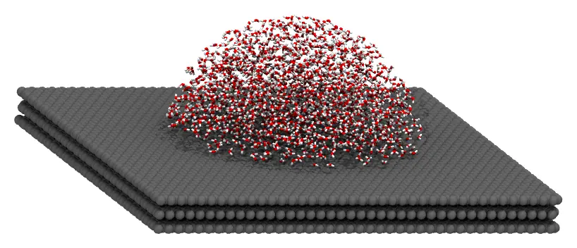
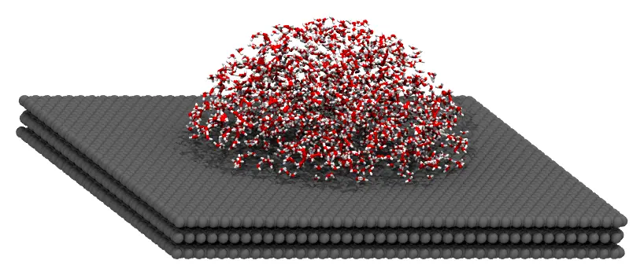
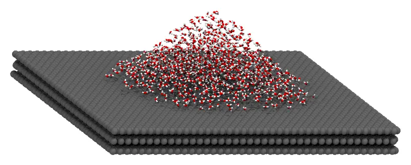

# Water drop on graphite

A drop of water on a graphite surface. The graphite (three layers of graphene) is a fixed
molecule, and the water is packed in the shape of the drop: the cap of a sphere, or a
Gaussian. The drops are drawn with constraints only, so their shape is chosen freely: it
can be adjusted to a contact angle, for instance.



Files: [`graphite.pdb`](files/water_drop/graphite.pdb),
[`water.pdb`](files/water_drop/water.pdb), and the input files
[`drop.inp`](files/water_drop/drop.inp) and
[`gaussian_drop.inp`](files/water_drop/gaussian_drop.inp).

The graphite has three layers of graphene, 3.35 Å apart, with the surface at `z = 0`, of
about 98 × 98 Å (11040 carbon atoms). It was built with the Julia code at the end of this
page.

## Command line

The input file:

```
#
# A drop of water on graphite: the cap of a sphere with a radius of 30 Å,
# above z = 2 (1700 water molecules, 1 g/mL), on three fixed layers of graphene.
#
tolerance 2.0
output drop.pdb

# Graphite, kept at the coordinates of the file (surface at z = 0)
structure graphite.pdb
  number 1
  fixed 0. 0. 0. 0. 0. 0.
end structure

# The drop: inside a sphere centered on the surface, above the surface
structure water.pdb
  number 1700
  inside sphere 0. 0. 0. 30.
  above plane 0. 0. 1. 2.
end structure
```

`fixed 0. 0. 0. 0. 0. 0.` keeps the graphite at the coordinates of its file (see [Fixed
molecules](../constraints/fixed.md)). The number of water molecules follows from the
volume of the cap of the sphere above `z = 2`: ``\pi h^2 (3R - h)/3`` with `R = 30` and
`h = 28` Å, that is, about 50900 ų, which holds 1700 water molecules at 1 g/mL (0.0334
molecules per ų).

### Check the initial approximation first

Add the `check` keyword to the input file, and run it as below. Packmol builds only the
initial approximation, in a fraction of a second: the molecules are in the drop, but may
still overlap. It is written to the output file (`drop.pdb`):



When the drop has the intended shape, remove `check`, and run the packing.

### Packing

```
packmol drop.inp
```

The packing takes a fraction of a second.

### A Gaussian drop

The radially symmetric Gaussian surface (see [Gaussian, wave, and exponential
surfaces](../constraints/gaussian_wave_and_exponential_surfaces.md)) gives a drop with
the shape of a Gaussian: below the surface ``z = 2 + 25 \exp(-r^2/(2 \cdot 15^2))``,
where ``r`` is the distance from the `z` axis, and above the plane `z = 2`:

```
structure water.pdb
  number 1050
  below radial_gaussian 0. 0. 1. 0. 0. 0. 2. 25. 15.
  above plane 0. 0. 1. 2.
  inside cylinder 0. 0. 0. 0. 0. 1. 35. 40.
end structure
```

Far from the axis, the region between the plane and the Gaussian is a film too thin for
a water molecule. Without the cylinder, which keeps the drop within 35 Å of the axis, the
molecules placed there cannot satisfy the constraints, and Packmol stops after the initial
approximation with an error: an example of how badly designed constraints are detected
early. Within the cylinder, the drop has a volume of about 33000 ų (1050 water
molecules). The complete input file is [`gaussian_drop.inp`](files/water_drop/gaussian_drop.inp).



## Julia

```julia
using Packmol

graphite = structure_type("graphite.pdb";
    number = 1,
    fixed = ([0., 0., 0.], [0., 0., 0.]),
)
water = structure_type("water.pdb";
    number = 1700,
    constraints = [InsideSphere([0., 0., 0.], 30.), AbovePlane([0., 0., 1.], 2.)],
)
system = PackmolSystem([graphite, water]; output = "drop.pdb", tolerance = 2.0)
packmol(system)
```

As with the input file, check the initial approximation first, with
`PackmolSystem(...; check = true)`.

The Gaussian drop:

```julia
water = structure_type("water.pdb";
    number = 1050,
    constraints = [
        BelowRadialGaussian([0., 0., 1.], [0., 0., 0.], 2., 25., 15.),
        AbovePlane([0., 0., 1.], 2.),
        InsideCylinder([0., 0., 0.], [0., 0., 1.], 35., 40.),
    ],
)
system = PackmolSystem([graphite, water]; output = "gaussian_drop.pdb", tolerance = 2.0)
packmol(system)
```

### Building the graphite

The graphite was built with [PDBTools.jl](https://github.com/m3g/PDBTools.jl): graphene has
a rectangular cell of 2.46 × 4.26 Å with 4 carbon atoms, and the layers are 3.35 Å apart,
in AB stacking (every other layer shifted by one C–C bond, 1.42 Å):

```julia
using PDBTools

function build_graphite(; nx = 40, ny = 23, nlayers = 3, a = 2.46, d = 1.42)
    cell = [(0.0, 0.0), (a / 2, d / 2), (a / 2, 3d / 2), (0.0, 2d)]
    Lx, Ly = nx * a, ny * 3d
    atoms = Atom{Nothing}[]
    for layer in 0:nlayers-1, i in 0:nx-1, j in 0:ny-1, (x, y) in cell
        shift = isodd(layer) ? d : 0.0
        push!(atoms, Atom(; name = "C", resname = "GRA", resnum = layer + 1, chain = "A",
            x = i * a + x - Lx / 2,
            y = mod(j * 3d + y + shift, Ly) - Ly / 2,
            z = -3.35 * layer,
            pdb_element = "C",
        ))
    end
    return atoms
end

write_pdb("graphite.pdb", build_graphite())
```
