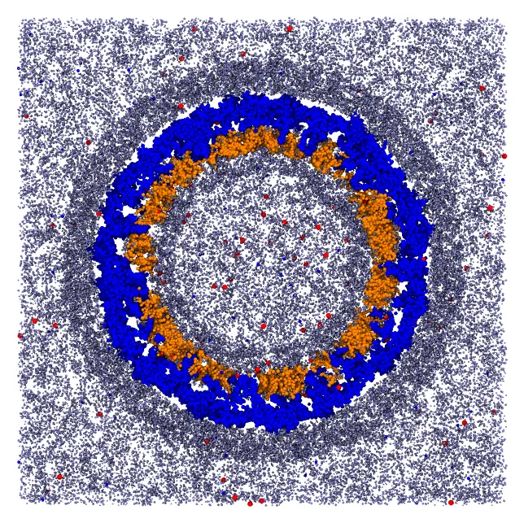
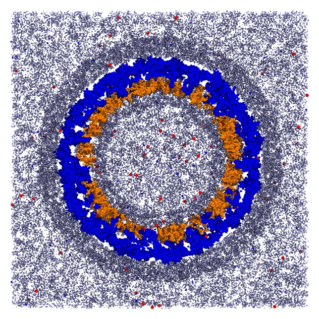

# Zika virion (a large system)

A complete virion of the Zika virus, in a coarse-grained model (SIRAH): the protein shell
of the virion, fixed, with a membrane of two layers of lipids (POPC, POPE and POPS)
beneath it, solvated by water and ions inside the membrane, between the membrane and the
proteins, and outside. The system has 2.77 million particles and 549 thousand molecules,
in a box with sides of 674 Å, and packs in about half an hour to an hour.



*A slab through the center of the virion: the protein shell (blue), the two layers of the
membrane (orange), water (gray) and ions (red and blue).*

The files are the `packmol_zika` set of
[MolSimTestFiles](https://github.com/m3g/MolSimTestFiles): download and extract
[packmol_zika.tar.gz](https://github.com/m3g/MolSimTestFiles/releases/download/packmol_zika-v1/packmol_zika.tar.gz)
(7 MB), which contains the input file `zika.inp` and the structures: `capsid.pdb` (the
protein shell, 489960 particles), `popc.pdb`, `pope.pdb` and `pops.pdb` (the lipids),
`wt4.pdb` and `wls.pdb` (two models of water of SIRAH), and `NaW.pdb` and `ClW.pdb` (the
ions).

## The regions of the system

Everything is organized in spherical shells around the center of the protein shell, which
is fixed at the origin. The proteins occupy the region between about 150 and 250 Å from
the center, mostly between 177 and 230 Å, with transmembrane segments crossing the
membrane:

| Component | Region (distance from the center, Å) |
|---|---|
| Inner layer of the membrane | heads (bead 1) below 160, ends of the chains above 170 |
| Outer layer of the membrane | ends of the chains below 175, heads above 180 |
| Water inside the membrane | WT4 between 120 and 160, WLS below 150 |
| Water between the membrane and the proteins | WT4 between 175 and 195 |
| Water outside | WT4 between 230 and 280, WLS outside 230, in the box |
| Ions | inside 180, between 180 and 215, and outside 220 |

The lipids are oriented only by their extreme beads: the head (bead 1) and the end of a
chain (bead 16, or 17 in POPS), which are 21 to 25 Å apart. The surfaces that bound them
are 10 Å apart in the inner layer and 5 Å apart in the outer one, less than half the
length of the lipids, which leaves them room to bend and tilt while being packed.

## Command line

The input file (`zika.inp`), with the first structures of each kind (the complete file
is in the tarball):

```
tolerance 2.0
output zika.pdb

structure capsid.pdb
  number 1
  center
  fixed 0. 0. 0. 0. 0. 0.
end structure

#
# Outer layer of the membrane: heads (bead 1) outside r = 180 Å, ends of the
# chains (bead 16, or 17 in POPS) inside r = 175 Å
#
structure popc.pdb
  number 2185
  atoms 16
    inside sphere 0. 0. 0. 175.
  end atoms
  atoms 1
    outside sphere 0. 0. 0. 180.
  end atoms
end structure

# ... POPE and POPS in the outer layer

#
# Inner layer of the membrane: heads inside r = 160 Å, ends of the chains
# outside r = 170 Å
#
structure popc.pdb
  number 2855
  atoms 16
    outside sphere 0. 0. 0. 170.
  end atoms
  atoms 1
    inside sphere 0. 0. 0. 160.
  end atoms
end structure

# ... POPE and POPS in the inner layer

#
# Water inside the membrane: around and within the capsid
#
structure wt4.pdb
  number 17903
  inside sphere 0. 0. 0. 160.
  outside sphere 0. 0. 0. 120.
end structure

structure wls.pdb
  number 23500
  inside sphere 0. 0. 0. 150.
end structure

# ... water between the membrane and the proteins, and outside

structure wls.pdb
  number 400000
  inside box -337. -337. -337. 337. 337. 337.
  outside sphere 0. 0. 0. 230.
end structure

# ... ions
```

### Check the initial approximation first

For a system of this size, checking the initial approximation is essential: the packing
takes half an hour, but the initial approximation takes about 10 seconds. Add the `check`
keyword to the input file, and run it:

```
packmol zika.inp
```

The initial approximation is written to the output file (`zika.pdb`). A slab through its
center shows that every component is in its region:



*The initial approximation: the molecules are in their regions, but may overlap.*

Only then remove `check`, and run the packing.

### Packing

```
packmol zika.inp
```

The packing converged in 39 loops, which took 58 minutes with 14 threads, and about half
an hour with 32 threads, using 3.7 GB of memory (the initial approximation alone uses
about 2.3 GB). By default, the `packmol` executable
uses all the cores of the machine; `packmol -t N` limits it to `N` threads.

!!! tip "Large systems"
    - Check the initial approximation first (`check`): mistakes in the constraints of a
      system of this size are expensive to find after the packing.
    - `restart_to` writes the coordinates of a structure (or of the whole system) at the
      end of the packing, and `restart_from` reads them back, to pack the system in parts:
      for example, the membrane first, and then the solvent around it (see [Restarting a
      run](../input_files/restarting_a_run.md)).
    - The memory and the time grow roughly linearly with the number of particles.

## Julia

The same system, built in Julia, with the regions of the lipids given once for each layer:

```julia
using Packmol

capsid = structure_type("capsid.pdb";
    number = 1, fixed = ([0., 0., 0.], [0., 0., 0.]), center = :geometric,
)

# The lipids of a layer: head (bead 1) and end of the chain (bead 16, or 17 in POPS)
function layer(file, number, tail, head_region, tail_region)
    structure_type(file; number, atom_constraints = [[1] => head_region, [tail] => tail_region])
end
origin = [0., 0., 0.]
outer = (OutsideSphere(origin, 180.), InsideSphere(origin, 175.))
inner = (InsideSphere(origin, 160.), OutsideSphere(origin, 170.))
lipids = [
    layer("popc.pdb", 2185, 16, outer...), layer("pope.pdb", 1079, 16, outer...),
    layer("pops.pdb", 367, 17, outer...),
    layer("popc.pdb", 2855, 16, inner...), layer("pope.pdb", 1441, 16, inner...),
    layer("pops.pdb", 473, 17, inner...),
]

box = InsideBox([-337., -337., -337.], [337., 337., 337.])
solvent = [
    structure_type("wt4.pdb"; number = 17903,
        constraints = [InsideSphere(origin, 160.), OutsideSphere(origin, 120.)]),
    structure_type("wls.pdb"; number = 23500, constraints = [InsideSphere(origin, 150.)]),
    structure_type("wt4.pdb"; number = 7551,
        constraints = [OutsideSphere(origin, 175.), InsideSphere(origin, 195.)]),
    structure_type("wt4.pdb"; number = 85127,
        constraints = [OutsideSphere(origin, 230.), InsideSphere(origin, 280.)]),
    structure_type("wls.pdb"; number = 400000, constraints = [box, OutsideSphere(origin, 230.)]),
]
ions = [
    structure_type(ion; number, constraints)
    for (ion, numbers) in (("NaW.pdb", (616, 256, 2908)), ("ClW.pdb", (531, 167, 2422)))
    for (number, constraints) in zip(numbers, (
        [InsideSphere(origin, 180.)],
        [OutsideSphere(origin, 180.), InsideSphere(origin, 215.)],
        [OutsideSphere(origin, 220.), box],
    ))
]

system = PackmolSystem([capsid; lipids; solvent; ions];
    output = "zika.pdb",
    tolerance = 2.0,
    check = true, # the initial approximation only; remove to pack
)
packmol(system)
```
