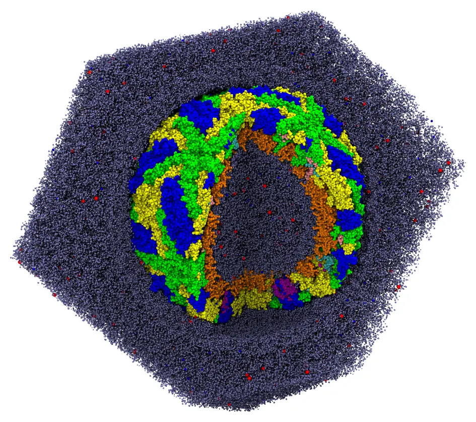
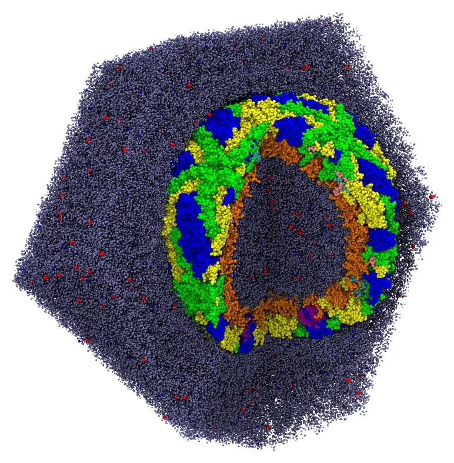

# Zika virion (a large system)

A complete virion of the Zika virus, in a coarse-grained model
([SIRAH](https://www.sirahff.com/)): the protein shell
of the virion, fixed, with a membrane of two layers of lipids (POPC, POPE and POPS)
beneath it, solvated by water and ions inside the membrane, between the membrane and the
proteins, and outside, in a rhombic dodecahedron periodic cell with 674 Å between
opposite faces. The system has 2.20 million particles and 407 thousand molecules.



*A slab through the center of the virion: the protein shell (blue), the two layers of the
membrane (orange), water (gray) and ions (red and blue).*

The files are the `packmol_zika` set of
[MolSimTestFiles](https://github.com/m3g/MolSimTestFiles): download and extract
[packmol_zika.tar.gz](https://github.com/m3g/MolSimTestFiles/releases/download/packmol_zika-v2/packmol_zika.tar.gz)
(7 MB), which contains the input file `zika.inp` and the structures: `capsid.pdb` (the
protein shell, 489960 particles), `popc.pdb`, `pope.pdb` and `pops.pdb` (the lipids),
`wt4.pdb` and `wls.pdb` (two models of water of [SIRAH](https://www.sirahff.com/)), and
`NaW.pdb` and `ClW.pdb` (the ions).

## The regions of the system

Everything is organized in spherical shells around the center of the protein shell, which
is fixed at the origin. The proteins occupy the region between about 150 and 250 Å from
the center, mostly between 177 and 230 Å, with transmembrane segments crossing the
membrane:

| Component | Region (distance from the center, Å) |
|---|---|
| Inner layer of the membrane | heads (bead 1) below 160, ends of the chains above 170 |
| Outer layer of the membrane | ends of the chains below 175, heads above 180 |
| Water inside the membrane | WT4 between 120 and 160, WLS below 150 |
| Water between the membrane and the proteins | WT4 between 175 and 195 |
| Water outside | WT4 between 230 and 280, WLS outside 230 |
| Ions | inside 180, between 180 and 215, and outside 220 |

The periodic cell is a rhombic dodecahedron (`pbc dodecahedral 0. 0. 0. 674.`, see
[Rhombic dodecahedron box](../periodic_boundary_conditions/rhombic_dodecahedral_box.md)):
its periodic images are as far apart as those of a cubic box with sides of 674 Å, but it
has 71% of the volume of that box, and the water and the ions outside the virion are
only those that fill it. The regions outside the virion need no other constraint: the
periodic cell bounds them.

The lipids are oriented only by their extreme beads: the head (bead 1) and the end of a
chain (bead 16, or 17 in POPS), which are 21 to 25 Å apart. The surfaces that bound them
are 10 Å apart in the inner layer and 5 Å apart in the outer one, less than half the
length of the lipids, which leaves them room to bend and tilt while being packed.

## Command line

The input file, [`zika.inp`](files/zika/zika.inp):

```@raw html
<details><summary>The input file <code>zika.inp</code> (click to expand)</summary>
```
```@eval
Main.input_file("files/zika/zika.inp")
```
```@raw html
</details><br>
```

### Check the initial placement first

For a system of this size, checking the initial placement is essential: the packing takes
several minutes, but the initial placement takes about 30 seconds (see
[Checking the initial placement](@ref check_initial_placement)). Uncomment the
`check_initial_placement` line of the input file, and run it:

```
packmol zika.inp
```

The initial approximation is written to the output file (`zika.pdb`). A slab through its
center shows that every component is in its region:



*The initial approximation: the molecules are in their regions, but may overlap.*

Only then comment the line again, and run the packing.

### Packing

```
packmol zika.inp
```

The packing converged in 2 loops, which took 7 minutes with 14 threads, using 3.7 GB
of memory (the check of the initial approximation takes 30 seconds and 3.6 GB). By
default, the `packmol` executable
uses all the cores of the machine; `packmol -t N` limits it to `N` threads.

!!! tip "Large systems"
    - Check the initial placement first (`check_initial_placement`): mistakes in the
      constraints of a system of this size are expensive to find after the packing.
    - `restart_from` reads the coordinates of a previous output back, to pack the system
      in parts: for example, the membrane first, and then the solvent around it (see
      [Restarting a run](../input_files/restarting_a_run.md)).
    - The memory and the time grow roughly linearly with the number of particles.

## Julia

The same system, built in Julia, with the regions of the lipids given once for each layer:

```julia
using Packmol

capsid = structure_type("capsid.pdb";
    number = 1, fixed = ([0., 0., 0.], [0., 0., 0.]), center = :geometric,
)

# The lipids of a layer: head (bead 1) and end of the chain (bead 16, or 17 in POPS)
function layer(file, number, tail, head_region, tail_region)
    structure_type(file; number, atom_constraints = [[1] => head_region, [tail] => tail_region])
end
origin = [0., 0., 0.]
outer = (OutsideSphere(origin, 180.), InsideSphere(origin, 175.))
inner = (InsideSphere(origin, 160.), OutsideSphere(origin, 170.))
lipids = [
    layer("popc.pdb", 2185, 16, outer...), layer("pope.pdb", 1079, 16, outer...),
    layer("pops.pdb", 367, 17, outer...),
    layer("popc.pdb", 2855, 16, inner...), layer("pope.pdb", 1441, 16, inner...),
    layer("pops.pdb", 473, 17, inner...),
]

solvent = [
    structure_type("wt4.pdb"; number = 17903,
        constraints = [InsideSphere(origin, 160.), OutsideSphere(origin, 120.)]),
    structure_type("wls.pdb"; number = 23500, constraints = [InsideSphere(origin, 150.)]),
    structure_type("wt4.pdb"; number = 7551,
        constraints = [OutsideSphere(origin, 175.), InsideSphere(origin, 195.)]),
    structure_type("wt4.pdb"; number = 85127,
        constraints = [OutsideSphere(origin, 230.), InsideSphere(origin, 280.)]),
    structure_type("wls.pdb"; number = 259500, constraints = [OutsideSphere(origin, 230.)]),
]
ions = [
    structure_type(ion; number, constraints)
    for (ion, numbers) in (("NaW.pdb", (616, 256, 2078)), ("ClW.pdb", (531, 167, 1592)))
    for (number, constraints) in zip(numbers, (
        [InsideSphere(origin, 180.)],
        [OutsideSphere(origin, 180.), InsideSphere(origin, 215.)],
        [OutsideSphere(origin, 220.)],
    ))
]

system = PackmolSystem([capsid; lipids; solvent; ions];
    output = "zika.pdb",
    tolerance = 2.0,
    unitcell = dodecahedral_unitcell(Float64, 674.0), # centered at the origin
    # check_initial_placement = true, # uncomment to only place the molecules
)
# Write the output in the shape of the rhombic dodecahedron
triclinic_to_dodecahedral(system)
packmol(system)
```
